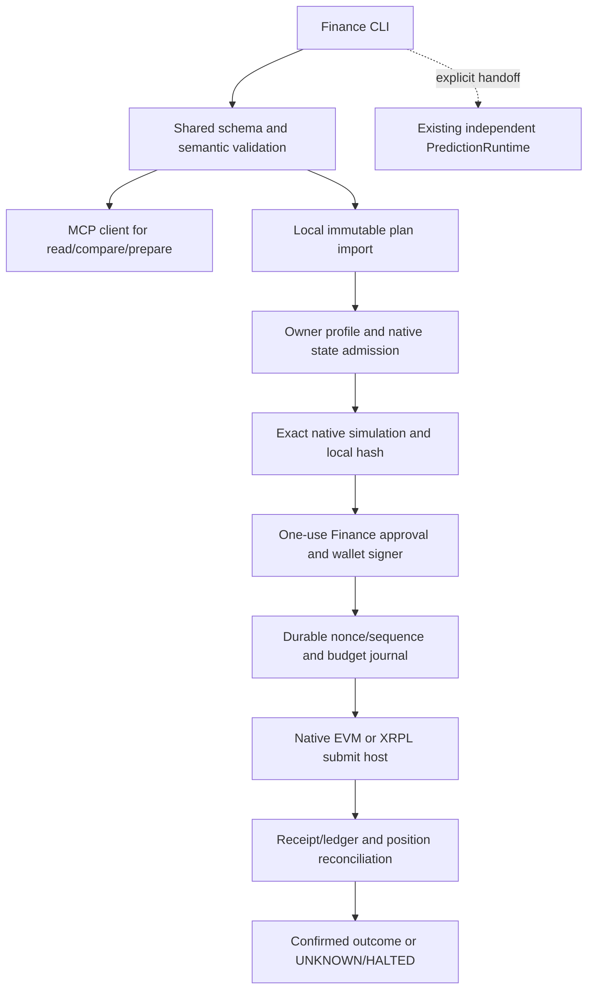

# AI Finance upgrade PRD — rollover-skill

**Date:** 2026-11-09. **Document status:** final implementation-analysis specification. **Implementation status:** NOT_STARTED. **Runtime/live E2E:** NOT_RUN. **Owner:** repository owner. **Networks:** XRPL native, Arbitrum One, Base, Robinhood Chain. **Delivery:** this single Markdown file is the complete repository handoff, including schemas, input/output examples, System Map, task dependencies, Gstack review and E2E requirements.

Companion: [the other repository PRD](../../hypermove/hypermove-app/AI-FINANCE-UPGRADE-PRD.md). Neither repository depends on this companion path at runtime. Contract ID `urn:openx:finance-wire:1`; canonical contract digest `8046b6f9d4ef51f9419481ccee4e49c567681df9fb3f48867b9194cff3de4edb`. No product source or existing uncommitted changes were altered to produce this document.

## Navigation

- [Client outcome](#client-outcome), [Scope](#scope), [Non-goals](#non-goals)
- [Architecture and repo changes](#implementation-architecture), [Shared contract rules](#shared-contract-and-semantic-rules)
- [Tasks](#implementation-tasks-and-order), [System Map](#nim-deliver-system-map)
- [E2E](#e2e-verification-plan), [Acceptance](#acceptance-criteria), [Environment](#environment-contract)
- [Gstack review](#gstack-review-and-decision-record), [Rollout](#rollout-and-rollback)
- [Machine schema](#appendix-a-complete-shared-json-schema), [Examples](#appendix-b-positive-and-negative-contract-vectors)

## Client outcome

An existing crypto holder can understand an admitted loan/account, compare ordinary repayment or risk reduction, see exact amounts/costs/permissions and choose a reviewed action. The result remains traceable through its actual native outcome. First useful output requires no signing key or new funded wallet. The product does not promise guaranteed savings, returns or liquidation prevention.

## Audience

Initial audience is existing MCP/skill users and one controlled borrower account per admitted market. A thin account UI supports ordinary users and research assistants. Professional arbitrage and the existing prediction runtime remain separate lanes. Validate at least ten observed borrower tasks and willingness to use/pay before treating the broad consumer account as commercially approved.

## Scope

The product is Finance mode on the existing flashloan stack: understand positions, compare an action, prepare it, approve locally, and reconcile its actual effect. Networks are native XRPL, Arbitrum One (42161), Base (8453), and Robinhood Chain (4663). Native XRPL is not XRPL EVM. Solana/Sui remain existing unrelated lanes and are outside this Finance release.

Release gates are deliberate: R0 contracts/capabilities; R1 read-only position reports; R2 unsigned preparation and ordinary user-approved actions; R3 one admitted smart-account flash debt recipe; R4 prediction context and independent-runtime handoff. A release may expose a network with UNKNOWN/UNSUPPORTED operations; it must not manufacture parity. Native XRPL credit is read-only in this contract; only native Payment preparation is specified. LoanPay, LoanSet and vault writes need a later independently versioned transaction contract after current amendment and standalone support are proven.

No new lending pool, bridge, token, universal custody system, second MCP server, or cross-chain flashloan is required. This PRD selects implementation decisions; it does not activate runtime procedures or authorize signing, deployment, real-money testing, or automatic memory-rule promotion.

## Non-goals

Changing legacy flashloan profitability floors, giving the public worker a signer, using model text as authority, generic arbitrary-call execution, automatic account/position migration, unsupported native credit writes, protocol deployment, cross-chain atomic credit, prediction-funded borrowing, a new wallet protocol, or automatic skill/rule activation. No present-tense support claim may be inferred from this target scope.

## Alternatives considered

1. A new standalone AI finance service duplicates current gateway, worker, storage, distribution and policy boundaries.
2. Adding Finance fields to pinned flash-run-request/1 breaks strict schemas and confuses debt postconditions with arbitrage profits.
3. An isolated Finance lane behind existing interfaces preserves current behavior and can be admitted progressively. Selected.

## Selected approach and why

Keep MCP research/unsigned preparation and local skill execution separate. Use one canonical generated contract, existing owner-scoped artifacts/jobs and native runtime helpers. Expose explicit operation-level capability and coverage. Ordinary user-signed actions precede flash-assisted smart-account recipes; native XRPL credit starts read-only. This produces a useful R0/R1 slice without claiming the full system is implemented.

## Implementation architecture

Repository role: the local source of truth for owner policy, exact native transaction validation, signer access, durable submission intent, confirmation and reconciliation. The MCP worker never supplies signing authority.



### Existing code and exact seams

| Existing file/symbol | Required change / invariant |
|---|---|
| `src/agent-cli.ts` | Preserve `flashloan-agent install`. Extend its packaging list for generated Finance schema/examples/manifests and optional instructions; no secrets/state. Do not confuse the installer binary with an existing Finance CLI. |
| `src/liquidity/runtime.ts` — LiquidityRuntime, LiquidityExecutionAdapter | Reuse narrow native admission, state, custody and reconciliation ideas; do not feed debt actions into RouteCandidate/closed-cycle arithmetic. |
| `src/liquidity/arbitrum-execution.ts` — EvmLiquidityExecutionAdapter | Reuse chain-specific fee/pin/receipt primitives through an adapter; keep route codecs for old arbitrage untouched. |
| `src/evidence/integration.ts` | Reuse exact canonical byte semantics and existing-field adapters; never edit vendor-pinned integration schema/hash. |
| `src/prediction/runtime.ts` — PredictionRuntime; `src/prediction/cli.ts` | Existing independent capital/grants/order lifecycle; only explicit context/handoff integration, no reimplementation. |
| `skills/flashloan-agent/SKILL.md`, prompt-v6 and version manifests | Add Finance instructions in a separate optional section/file packaged by installer. Keep stable v6 prompt bytes and version hash unchanged. |
| Proposed `src/finance/contracts.ts`, `client.ts`, `positions.ts`, `planner.ts`, `runtime.ts`, `journal.ts`, `cli.ts` | One cohesive Finance module; contract loader/client/native plan verification/policy and recovery have separate responsibilities. Reuse helper code rather than duplicate signing, fee, or JSON logic. |
| Proposed `schemas/finance-v1.schema.json`, `config/finance/` | Bundle generated canonical contract, documented owner profile and reviewed adapter manifest. Feature and live modes default off. |

CLI is a proposed new self-contained `node dist/finance/cli.js --config <profile>` which reads one bounded JSON object from stdin and prints one typed JSON result. For remote read/compare/prepare/watch/job operations it accepts Request and forwards a validated request to the configured authenticated MCP. For local import/simulate/execute/reconcile it accepts LocalRequest. `import-plan` accepts the full Plan and returns LocalResult.planRef; subsequent calls use only the local content-addressed reference. No shell command, dynamic code, endpoint URL or private key can be supplied by an intent. No implicit dotenv loading; use explicit host environment configuration.

Exit codes: 0 successful requested operation (including partial read with disclosed gaps), 2 blocked/unsupported/unknown, 1 genuine failure. Unknown send returns typed UNKNOWN and a durable action reference, not another execute suggestion. Logs go to bounded stderr/owner journal; stdout stays one JSON object. Watch is opt-in bounded observation only; it does not imply a background auto-executor.

### Local profile and policy

Profile matches the shared Profile definition. `enabled=false` or missing signer/approval key must still permit the existing unrelated CLI behavior and explicitly blocked Finance entry. `live=false` is the default. Keep all credentials as env/key-host references. `stateDirectory` resolves to an owner-restricted root, never an arbitrary request path; use atomic/fsynced writes and exclusive account+network+nonce/sequence/budget leases.

The local policy is authoritative. Requests can tighten but never loosen configured account/network/action/cost/exposure/freshness limits. A first-owner operator pilot can use the current signer host under a Finance-specific one-use grant, but a server-wide operator key is not a retail custody design. Ordinary EOA actions require that EOA's signature; R3 requires the position-owning smart account and audited callback/account adapter.

### Native adapter interface and outputs

Each adapter must implement `capabilities(context)`, `readAccount`, `readPosition`, `compileAction`, `simulateExact`, `validateSignedArtifact`, `submitKnownArtifact`, and `reconcileKnownReference` with typed native values. Unknown support never falls through to another chain or public broadcast host. Pinned implementation/ABI/bytecode and allowed protocol/account model are part of adapterRef. No seeded-caller/balance/storage override is production evidence.

Native EVM payloads are decoded against approved function selectors, exact arguments, account ownership and postconditions before signing. XRPL uses only the Payment contract in this version, current fee/reserve/sequence, optional admitted codec and a native sign-only host. The host must return a decodable signed artifact bound to exactly the approved unsigned fields plus legitimate signature fields. A hidden signAndSend operation, wrong network or empty blob is rejected.

LocalResult includes separate planRef and localPlanRef, optional Simulation and Receipt. `outcome=ok` for import/simulate never means funds moved. Finalized native outcome and economic reconciliation have separate evidence; MISMATCH/UNKNOWN retains reservations and halts further writes until reviewed. Do not count unsolicited balances as attributable profit or budget restoration.

### Inspected repository baseline

| Existing source | SHA-256 at review |
|---|---|
| `src/liquidity/arbitrum-execution.ts` | `9a9ca1521e798690e0600e45dd1b17621c7ded50095a9d0484866e690d5bff90` |
| `src/liquidity/runtime.ts` | `a8ade34725407ef48f1d39c3cf6796bd7abce63841b4d91885bcf978d94eadd9` |
| `src/prediction/runtime.ts` | `aeb6b4226f0898b908233ee94597836f5c07e8564a866eada1bbed479c733fdc` |
| `src/agent-cli.ts` | `ccb8809124cdb8054cbd3ed7655a57656bba05e39b262a449d9c2ec0d2c6dabd` |
| `schemas/flashloan-v6.schema.json` | `a5f4a58e438757f0511072465b5318289e59afb7bec3ca78154c5558e8f6ff2c` |
| `package.json` | `f6a0d0e3d19a400f04ce374a2e870ffb914492e6394435a967587fed525e6cd3` |
| `skills/flashloan-agent/SKILL.md` | `d0c99243ac375d62410237e4bd0cbe0649897066edac3ed9c8d64d3926abade3` |

Any relevant file drift requires re-checking the plan against actual code before implementation; preserve unrelated local changes.
## Network rollout and actual capability baseline

The live connected MCP snapshot on 2026-11-09 is a baseline, not an implementation promise. Its request ID is `168f4577-3040-421b-bba7-e98a6cc0cd3c`; global execution/can_execute/chain_native_verified were false.

| Network | Existing service baseline | Planned Finance R1 | R2/R3 admission |
|---|---|---|---|
| Arbitrum | Discovery, snapshot, quote and research true; native simulation/execution false | One admitted Aave position adapter and typed coverage | Native local fidelity, account authority, deployment pins, current cost and receipt reconciliation. |
| Base | Discovery, snapshot, quote and research true; native simulation/execution false | Aave/Morpho position reads and Base cost/context evidence | Canonical post-Denim blocks, Base-specific deployments, exact fee accounting, wallet approval. |
| Robinhood | Discovery/identity true; research/snapshot/quote false; verification_required true | Portfolio/discovery only until position operation independently admitted | Resolve actual registry/lender/adapter gate; a reviewed V4 manager does not automatically enable credit or quotes. |
| Native XRPL | Listed in networks/operation names; missing chain_capabilities row | Explicit per-operation row; native portfolio and optional feature-verified loan statement | Payment-only builder plus admitted native signer/simulator; native credit writes remain out of v1. No native flash lender established. |

Every capability entry carries observation time, reason and evidence. Service capabilities never self-authorize local execution. Prediction research can be visible for any account, but its actual settlement venue/network remains Base/Limitless in this scope. Prediction-context requests always use network=base, including when launched from another network page; keep the displayed context separate from that page's positions. No prediction venue is presumed on XRPL, Arbitrum or Robinhood. Solana/Sui work already present in either repo is preserved but not expanded by this PRD.

## Shared contract and semantic rules

The complete JSON Schema and test vectors are embedded in the appendices of both PRDs. They are identical across repos. Canonical producer: HyperMove `src/lib/mcp/flashloan/finance/finance-v1.schema.json`; generated consumer copy: skill `schemas/finance-v1.schema.json`. Package the consumer copy and public vectors; do not import the sibling repo or bd-team at runtime. A build fails on changed bytes/contract digest without an intentional version change. No mandatory shared-package dependency is needed.

### Boundary and amount semantics

1. All objects are closed. Reject unknown keys, duplicate JSON keys, invalid UTF-8, over-budget bodies, unsafe integers and wrong discriminators before billing or side effects. The worker repeats the same validation. Tools fix their operation constant and reject a mismatch with the selected tool name.
2. `network` must match every account, asset, observation, market, payload and receipt. Map Arbitrum/Base/Robinhood to 42161/8453/4663. Native XRPL has a native account and verified network-identity manifest, never an EVM chain ID. Address regex is syntax only: perform EVM checksum and native XRPL checksum/authorization validation through the admitted adapter. Lowercase EVM addresses only after validation, before canonical hashing.
3. ERC-20/native-EVM quantities and XRP drops are nonnegative base-unit strings. Reject values exceeding the native protocol width; no floating-point or silent rounding. ERC decimals >36 are unsupported in v1. Native issued amounts use signed coefficient × 10^exponent with at most 16 significant digits, exponent -96..80; canonical zero is coefficient `0`, exponent 0; strip insignificant trailing zeros within range. Do not impose ERC integer-decimal arithmetic on XRPL issued currencies. Action amounts must be strictly positive; read/account-balance sign semantics stay native. XRP uses six decimal places; issued currency identity is currency+issuer. Reserved native-currency aliases are not issued assets.
4. Timestamps are valid UTC `YYYY-MM-DDTHH:mm:ss.sssZ`, not just a regex match. All comparisons use an injected clock. EVM `block.timestamp` stays seconds; optional Base millisecond fields are distinct. Native loan dates use Ripple epoch; convert with tested epoch handling, including 0 → 2000-01-01T00:00:00.000Z. Never reinterpret an XRPL native loan as an EVM collateral health factor.
5. Every report states completeness, missing coverage and observation point. EVM reads are pinned to a canonical hash; XRPL reads to one validated ledger hash. Mixed-state results are rejected. Best-effort data may inform a clearly partial read report, but cannot admit preparation/execution. An unavailable market/feature returns UNKNOWN, not a zero balance or zero debt.
6. `PositionReport` is one network/account page. Aggregate views combine separate reports without merging spendability or authority. EVM no-debt has `noDebt=true, healthFactor=null`; do not serialize Infinity or the uint256 sentinel as a real risk score. Supplied lender balances are separate from collateral/debt; preserve Morpho supply/borrow shares with same-state conversion evidence and protocol rounding. An earn action requires minSupplyAfter, not an invented collateral increase. Native Loan IDs, issuer assets and underwriting/repayment fields keep native meaning.
7. `Constraints` are requested upper/lower bounds, not authority. Intersect request, current server capability, local owner policy, wallet permissions and protocol constraints. Empty cost/spend/postcondition arrays allow comparison only; preparation returns `MISSING_BOUND` if an applicable maximum/minimum is absent. A missing valuation never becomes a zero cost. USD comparisons require a fresh explicitly sourced price; enforce execution limits in asset units regardless.
8. Costs identify asset and payer. Base execution and L1/operator charges are separate when RPC reports them; avoid adding Nitro bundled data cost twice. Obtain fresh fee evidence near preparation and send. Zero lender fee is not zero total cost. A risk-reduction action uses debt/collateral/cost postconditions, never a lowered arbitrage profit floor. Existing arbitrage policy remains unchanged.
9. Schema-valid does not mean authorized or economically valid. In particular a structurally valid execute request, an empty set of constraints, `pass=true` in a caller result, a reviewed pool address, or a successful discovery response cannot enable execution.

### Exactly defined identities and hashes

Finance digests are lowercase, bare 64-character SHA-256 hex. Legacy integration/prediction `sha256:`-prefixed hashes retain their own types/domains; adapt only an explicitly named field after validation, never by generic casting.

Use UTF-8 canonical JSON: recursively sort object keys lexicographically as JavaScript UTF-16 keys; preserve array order; reject undefined/nonfinite/unsafe numeric values; JSON strings/booleans/null serialize normally. All schema keys and hash projection keys are ASCII. Integers in numeric schema fields must be safe integers. Reuse existing `canonicalBytes` semantics after golden-vector parity; do not modify legacy hash domains.

`contractDigest = SHA256(canonical(sharedSchema))`.

`requestDigest = SHA256(UTF8("openx/finance/request/1\n") || canonical(validatedRequest))`.

`planHash = SHA256(UTF8("openx/finance/research-plan/1\n") || canonical(Plan without planHash))`. It includes contract/request hashes, account/network, position/comparison refs, adapter pin, source observation, requested/effective constraints, permissions, cost maxima, exact unsigned native payload, expiry and evidence refs. Explanations rendered by an LLM are outside Plan and never authoritative.

The server's owner-scoped artifact ID is not planHash; the existing artifact wrapper/producer version is also not the Finance wire version. Preserve legacy artifact IDs and hash rules. A local import recomputes planHash and stores that immutable research Plan under its reference. Derive a typed LocalPlan by independently binding policyHash, current chain identity/state, exact native unsigned bytes, code/ABI/account-module/approval-key pins, final fee/nonce/sequence values and required finality. `localPlanHash = SHA256(UTF8("openx/finance/local-plan/1\n") || canonical(LocalPlan without localPlanHash))`. `policyHash` covers Profile with policyHash omitted and no secret values. LocalResult returns planRef and localPlanRef separately; execute requires the latter. Simulation results reference this local hash and are stored separately, avoiding circular hash inputs. The service can produce ResearchSimulation only, never a local execution hash from unavailable owner-policy inputs.

Research Plan is immutable. Before approval, local fee/nonce/state refresh may derive a new LocalPlan only within the original intent/constraints; every hash change needs exact re-simulation and a new grant. Account, target, selector, economic amount, asset or permission changes require a fresh research Plan. After approval no native bytes may be silently patched. LocalPlan fields are all hash-bound; display-only prose is outside it.

### Freshness, proof and authority

Preparation expiry is the minimum of configured quote/state/price/capability/permission/plan expiry. XRPL also uses the LastLedgerSequence cutoff. An expiry of null is allowed for a durable reference but cannot justify fresh state. A changed fee/nonce/sequence/ledger bound cannot be silently patched after approval.

Current public proof envelopes are service HMAC provenance, not a wallet grant, correctness certificate or native simulation proof. Do not distribute the server HMAC key to the skill. The skill independently verifies state, economics and exact native payload; authenticated server verification can confirm an exported service envelope without replacing native checks.

Wallet/account association is distinct from ownership, transaction delegation and consent. Watch-only accounts never authorize a write; a new embedded wallet does not own an old position. Finance live execution requires both an owner-controlled approval and the actual account signer/module permissions. `approvalRef` resolves only in the local owner journal; caller-created hashes are not grants. Approval grants use an independent Finance domain and owner-configured Ed25519 verification key (Node crypto; no server key), bind account/policy/local plan/nonce/expiry, and are one use. The authorizer belongs to the local owner host; MCP must not mint approval. A grant does not replace the wallet signature. Ordinary consumer wallets are not promised transparent auto-execution until that companion/approval integration has passed a pilot.

Grant signing bytes: `openx/finance/approval/1\n` + canonical(ApprovalGrant without grantId/signature). `grantId` is SHA256 of those bytes; signature is a canonical 64-byte Ed25519 signature encoded as base64. Trusted public key comes from the owner profile, never the request. The grant nonce is atomically reserved before signer access. Reject a grant for a different domain, account, policy, plan or expired time. Prediction grants never authorize Finance and vice versa.

### State and recovery

Server jobs: QUEUED → RUNNING → SUCCEEDED | FAILED | CANCELLED. SUCCEEDED means a research artifact was published, not a money movement. Existing owner+idempotency_key uniqueness is retained; input hash includes operation and finance contractDigest, so reusing a key with different input is a conflict. Clients namespace keys `finance:<operation>:<uuid>` but cannot choose the owner.

Local actions: PREPARED → SIMULATED → AWAITING_APPROVAL → SUBMITTING → SUBMITTED → INCLUDED → CONFIRMED → FINALIZED. FAILED/EXPIRED can occur before or after submission where justified. Transport ambiguity after signing/sending becomes UNKNOWN; reconciliation failure or mismatch becomes HALTED. Never mark success from an HTTP acknowledgement or a model's claimed outcome.

Persist the approved plan, signed-transaction hash, native nonce/sequence, cost reservation and SUBMITTING intent durably before network send. Keep pre-broadcast signed material in the local restricted owner store, never MCP or logs. After a crash, query the known hash; do not rebuild/repost an ambiguous action, release its budget, or reuse its nonce. Cancellation before sending releases only proven unspent reservations; after sending it stops new risk and continues reconciliation. Onchain completion cannot be rolled back by deleting a journal.

Service receipt import is untrusted evidence. Request `report-execution` requires `verification=local-reported`; the service independently checks receipt/ledger identity and outcome before presenting `chain-verified`. Bind the report to an owned plan/account/network. Receipt-block end state may include other transactions; ambiguous economic attribution remains UNKNOWN even when the transaction itself succeeded.

### Native XRPL scope and field mapping

R1 reads account/reserve/issued balances and, only where current LendingProtocol activation and actual objects are verified, Loan statements. Join Loan → LoanBroker → Vault/asset at the same validated ledger; the Loan object does not itself establish asset denomination. Preserve absent LoanScale as null, not an inferred default. Map PrincipalOutstanding, TotalValueOutstanding, ManagementFeeOutstanding, PeriodicPayment, PaymentRemaining and native flags explicitly. InterestRate is in tenths of a basis point: annual fraction = raw/100000, not raw/10000. Impairment can advance NextPaymentDueDate; do not treat the original schedule as immutable. Missing join/unit data yields incomplete coverage and no amount projection.

R2 native preparation is Payment only: no Paths, SendMax, DeliverMin, partial-payment flags, Batch, LoanPay or Vault operations. Sequence and TicketSequence are mutually constrained by the embedded schema. Read current fee/reserve/sequence or ticket, issuer transfer restrictions, trust-line availability, destination-tag requirements and spendable XRP. Fees and reserves are never hardcoded. Plain syntactic JSON is not simulation. If the configured native simulator is unsupported, leave the affected write unavailable; never fall back to an estimate labeled native.

For signed-blob decoding/signature verification, an optional exact-pinned XRPL codec host may be needed; the inspected HyperMove tree has xrpl 5.0.0 as a dev dependency, which is not evidence it exists in production. Do not import it unconditionally. Ship the admitted optional codec explicitly in the XRPL build/profile and reject signing when absent. The existing n-payment wallet fallback that calls signAndSend with hardcoded xrpl:testnet is not an admissible sign-only mainnet host. Reuse neither its network assumption nor its empty-blob-as-hash return.

### EVM protocol and account scope

R1/R2 initially admit one normal-mode variable-debt Aave V3 market on Arbitrum and Base and optionally one listed Morpho Blue market on Base after actual deployment/asset/oracle/LLTV validation. Unknown eMode/isolation/credit delegation, rebasing/fee-on-transfer assets, unlisted markets and curator vaults are reported or blocked, not assumed equivalent. A matching deployment hash and bounded adapter validation can expand scope in a later manifest without altering authority.

EOA positions support ordinary user-signed supply/withdraw/borrow/repay only where the protocol allows that signer. R3 flash protection supports only a separately admitted user-owned smart-account/module whose account actually owns the position and can authorize native repay/withdraw calls. Do not point the current operator-owned arbitrage executor at arbitrary borrower collateral. Borrow/repay callback, spender, lender/initiator, replay guard, allowable calls and cost/postcondition checks need their own reviewed account adapter. EOA-to-smart-account position migration is a separate user-approved workflow, never automatic onboarding.

### Deterministic action recipes and host gate

For ordinary actions, select an admitted market/account and an asset-unit amount under effective bounds. Earn compiles the market supply call with a bounded exact allowance if required; withdraw checks liquidity, ownership and resulting debt safety; borrow checks native protocol collateral/limit rules and resulting debt ceiling; repay checks owed amount, funding and debt reduction using native rounding. Comparison includes hold as a zero-action baseline and discloses whether protocol fees are included. A zero position is valid only after a successful same-state read of the admitted market; unavailable data never becomes a synthetic zero. No LLM generates calldata.

The R3 recipe is collateral-funded debt reduction in one admitted position-owning smart account: (1) select bounded debt-asset flash principal, (2) callback verifies lender, initiator, account, plan nonce and exact approved call list, (3) repay that account's variable debt, (4) withdraw only approved collateral still permitted by native protocol rules, (5) swap through the admitted exact-route adapter with minimum debt-asset output, (6) repay flash principal plus the freshly quoted lender fee, (7) return residue to the owning account, (8) enforce total spend/cost, maximum remaining debt, minimum retained collateral/supply and zero unexpected residual obligations. Revert the entire atomic recipe on any failed condition. No bridge, prediction order, arbitrary delegatecall, unknown spender or standing unlimited approval is allowed. Missing authorized account module or atomic callback adapter blocks R3; do not replace it with a sequence of independently irreversible EOA calls.

Explicit host adapters expose read, native simulation, sign-only, submit-known-artifact and reconcile operations separately. A host must test both the typed result and the harness envelope: `verified !== true` blocks publication/execution even when the promise resolves or the trace status says success. Runtime error recovery and strict output verification are distinct. Never assume an invalid result must throw. Cache only immutable evidence or a validation verdict keyed by exact content+validator version; fee/state/approval admission is recomputed and cannot be cached into standing authority.

### Error taxonomy

Required codes include FEATURE_DISABLED, CONTRACT_MISMATCH, INVALID_INPUT, AUTH_REQUIRED, OWNER_SCOPE_MISMATCH, WRONG_CHAIN, UNSUPPORTED_ACCOUNT_MODEL, CAPABILITY_UNAVAILABLE, FEATURE_STATE_UNKNOWN, COVERAGE_INCOMPLETE, MISSING_BOUND, POLICY_REJECTED, STALE_STATE, EXPIRED_PLAN, CODE_DRIFT, PERMISSION_MISSING, RESERVE_INSUFFICIENT, TRUSTLINE_REQUIRED, DESTINATION_TAG_REQUIRED, SIMULATION_UNAVAILABLE, SIMULATION_FAILED, IDEMPOTENCY_CONFLICT, APPROVAL_REQUIRED, APPROVAL_REPLAY, DEPENDENCY_TIMEOUT, SUBMISSION_UNKNOWN, RECONCILIATION_MISMATCH and PRIVACY_BLOCKED. Existing lower-level errors may be retained in typed evidence, not leaked as full credential-bearing exceptions. No retry on auth/schema/authority/contract failures. Retry bounded idempotent reads only within the remaining shared deadline; a send timeout always reconciles first.

## Implementation tasks and order

All tasks are pending implementation; dependencies identify the responsible repo rather than imply they already exist. A stage ships only its completed/tested subset.

| ID | Stage | Depends on | Concrete work | Done condition |
|---|---|---|---|---|
| SK-01 | R0 | none | Pin source/installed manifests, old prompt/schema goldens and independent prediction package; declare default-off Finance entry. | Package/version report and no unrelated behavior change. |
| SK-02 | R0 | MC-01 | Import generated shared schema/digest and vectors; implement exact structural, amount/hash and semantic validators. | Both repos accept/reject identical vectors and reject tampering. |
| SK-03 | R1 | SK-02; MC-03 | Authenticated MCP client and typed Job polling; import reports/plans into owner store. | No worker token, signing key or sibling runtime dependency. |
| SK-04 | R1 | SK-03 | Position coverage and read-only compare UI/CLI output; protocol/account identities preserved. | No watch-only write; unknown market remains explicit. |
| SK-05 | R2 | SK-02; MC-05 | Finance profile, effective constraint intersection, exact native local plan hash and one-use grants. | Every bound mutation invalidates prior simulation/approval. |
| SK-06 | R2 | SK-05 | Ordinary Aave/Morpho native action adapters for admitted EOA markets; exact viem simulation. | Actual caller authority and complete cost/postcondition checks. |
| SK-07 | R2 | SK-05 | Fsynced per-account/network/nonce/sequence/budget journal and crash recovery. | Unknown send cannot resend, reuse nonce or release reservations. |
| SK-08 | R2 | SK-06; SK-07 | Owner-reviewed ordinary EVM pilot and native receipt/position reconciliation. | Fixture/model cannot pass live admission; failures/costs reported. |
| SK-09 | R2 native optional | SK-05; MC-06 | Optional admitted XRPL codec/sign-only host, Payment-only builder checks, fee/reserve and validated-ledger reconciliation. | Reject hardcoded-testnet signAndSend fallback and missing native simulation. |
| SK-10 | R3 | SK-08; separate account adapter review | One position-owning smart-account flash recipe; pin callbacks/code and repayment guard. | No arbitrary EOA collateral; all negative callback/permission cases revert. |
| SK-11 | R4 | SK-02; MC-08 | Reuse independent PredictionRuntime; validate context/handoff and separate authority/budget. | No flash prompt mutation, borrow-to-bet or grant crossover. |
| SK-12 | all | SK-01..SK-11 applicable stage | Installer/package export, isolated install test, focused regression and post-delivery evidence. | No .env/.nim/signing material; no source/install drift silently shipped. |

## Nim-deliver System Map

The map is complete as a specification but remains Draft because the product code/proofs are not implemented. Future source paths and commands below are assigned tasks, not claimed existing tests. Approve this map explicitly before changing its status; mark Done only after actual implementation and evidence.

```json nim-deliver
{
  "featureId": "finance-skill-v1",
  "taskType": "feature",
  "status": "Draft",
  "input": {
    "entrypoint": "node dist/finance/cli.js --config <owner-profile.json>",
    "payload": "finance.request/1 for remote reads; finance.local-request/1 and Plan for local operations"
  },
  "processing": {
    "apiHops": [
      "Authenticated MCP client (read/prepare only)",
      "Native provider read/simulation",
      "Owner-controlled signer and admitted submission endpoint"
    ],
    "datastores": [
      "Restricted local owner attempt/grant/budget journal",
      "Imported content-addressed plans"
    ],
    "services": [
      "Existing EVM runtime and optional native XRPL codec/signing host",
      "Independent PredictionRuntime"
    ]
  },
  "output": {
    "state": "Typed LocalResult and native receipt reconciliation; unverified outcomes halt",
    "transitions": [
      "PREPARED -> SIMULATED -> AWAITING_APPROVAL -> SUBMITTING -> SUBMITTED -> native confirmation -> FINALIZED",
      "Unknown send -> UNKNOWN/HALTED -> reconcile; never blind resend"
    ]
  },
  "seams": [
    {
      "id": "boundary",
      "description": "Untrusted JSON or MCP transport to validated Finance input"
    },
    {
      "id": "state",
      "description": "Capability and protocol state acquisition under a deadline"
    },
    {
      "id": "authority",
      "description": "Owner/plan/policy and concurrent reservation boundary"
    },
    {
      "id": "native",
      "description": "Native payload preparation or local simulation boundary"
    },
    {
      "id": "recovery",
      "description": "Job/artifact/action publication and recovery boundary"
    }
  ],
  "edgeProofs": [
    {
      "edgeId": "EDGE-01",
      "seamId": "boundary",
      "command": "node --test --test-name-pattern=EDGE-01 dist/test/finance-e2e.test.js",
      "logMarker": "FINANCE_SKILL_EDGE-01_PROVEN",
      "sourceFiles": [
        "src/test/finance-e2e.test.ts",
        "src/finance/runtime.ts"
      ]
    },
    {
      "edgeId": "EDGE-02",
      "seamId": "state",
      "command": "node --test --test-name-pattern=EDGE-02 dist/test/finance-e2e.test.js",
      "logMarker": "FINANCE_SKILL_EDGE-02_PROVEN",
      "sourceFiles": [
        "src/test/finance-e2e.test.ts",
        "src/finance/runtime.ts"
      ]
    },
    {
      "edgeId": "EDGE-03",
      "seamId": "authority",
      "command": "node --test --test-name-pattern=EDGE-03 dist/test/finance-e2e.test.js",
      "logMarker": "FINANCE_SKILL_EDGE-03_PROVEN",
      "sourceFiles": [
        "src/test/finance-e2e.test.ts",
        "src/finance/runtime.ts"
      ]
    },
    {
      "edgeId": "EDGE-04",
      "seamId": "native",
      "command": "node --test --test-name-pattern=EDGE-04 dist/test/finance-e2e.test.js",
      "logMarker": "FINANCE_SKILL_EDGE-04_PROVEN",
      "sourceFiles": [
        "src/test/finance-e2e.test.ts",
        "src/finance/runtime.ts"
      ]
    },
    {
      "edgeId": "EDGE-05",
      "seamId": "recovery",
      "command": "node --test --test-name-pattern=EDGE-05 dist/test/finance-e2e.test.js",
      "logMarker": "FINANCE_SKILL_EDGE-05_PROVEN",
      "sourceFiles": [
        "src/test/finance-e2e.test.ts",
        "src/finance/runtime.ts"
      ]
    }
  ]
}
```

## E2E verification plan

All rows below are required implementation acceptance, currently **NOT_RUN**. Fixture/local contract proof is separate from read-only chain verification, pinned forks and funded pilot evidence. A skipped prerequisite is BLOCKED, not PASS. The implementation must not change a System Map to Done merely to satisfy the verifier.

| ID | Flow and injected failure | Required result and observable evidence |
|---|---|---|
| E2E-01 | Flags disabled; run legacy v6/v8/research/prediction fixtures | Byte-identical accepted outputs/catalogs, no Finance network/DB/fs calls. |
| E2E-02 | Valid capabilities on all four network entries | Per-operation states; XRPL explicit; Robinhood gate preserved; no execution escalation. |
| E2E-03 | Anonymous or cross-owner position/artifact/watch requests | Authentication/NOT_FOUND boundary; no billing before input/auth validation; no data leakage. |
| E2E-04 | Public wallet/read report without connected signer | Useful partial/read report; zero signer calls. New embedded wallet cannot control old loan. |
| E2E-05 | Real captured Arbitrum/Base Aave/Morpho payloads | Correct fields, addresses, units, zero-debt normalization and explicit unsupported markets. |
| E2E-06 | Reorg, mixed block or mixed XRPL ledger; source partly unavailable | Reject mixed state, or clearly partial read; no admissible write plan. |
| E2E-07 | Duplicate JSON keys, invalid UTF-8, numeric raw amounts, giant input, owner injection | Reject before side effects with bounded typed output; no secrets in errors. |
| E2E-08 | XRPL reserve/trustline/tag prerequisites and wrong issuer | Explain missing setup and block unsafe preparation; no fixed reserves or issuer substitution. |
| E2E-09 | XRPL Loan joins/rate/epoch/absent LoanScale/impairment | Native quantities and due date correct; rate raw 500=0.5% annual; epoch0=2000-01-01 UTC; missing fields stay unknown. |
| E2E-10 | Native Loan/Vault request wrapped in Batch or generic flash request | Unsupported in v1; never route through EVM executor or a native Batch shortcut. |
| E2E-11 | Compare hold/ordinary repay/protect with unknown prices, costs or empty bounds | Incomplete/blocked action with reason; no fabricated net savings/zero fees; hold requires no transaction. |
| E2E-12 | Valid Plan exported by MCP and imported by packaged skill | Exact contract/plan digests; separate artifact ID; no sibling/bd-team runtime import. |
| E2E-13 | Mutate any network/account/amount/fee/nonce/sequence/expiry/permission/hash field | Local hash changes; old simulation/grant invalid; no silent repair after approval. |
| E2E-14 | Fixture/model simulation claimed native or positive generic revm result | Cannot admit live execution; chain-native parity, pins and no unsafe overrides required. |
| E2E-15 | Wrong grant domain/key/account/policy, expired/reused approval | Reject; no signing; prediction and Finance grants cannot cross-authorize. |
| E2E-16 | Two tabs/processes act on same account/nonce/sequence/budget | One durable reservation; loser blocked; no duplicate send or premature reservation release. |
| E2E-17 | Crash before signing, after signing, after SUBMITTING and after send before acknowledgement | Recover from fsynced evidence; known hash reconciled; ambiguous outcomes stay UNKNOWN/HALTED. |
| E2E-18 | Ordinary EVM supply/borrow/repay/withdraw on local/fork protocol fixture | Actual authorized caller and exact calldata; correct native fee and protocol postconditions; reject unsupported account modes. |
| E2E-19 | R3 flash recipe with authorized smart account, wrong lender callback, insufficient repay or cost bound breach | Positive path repays in same transaction; each bad case reverts without claimed partial success. |
| E2E-20 | Native Payment positive/negative ledger results; sign-only host attempts send/testnet mismatch | Blob decoded and bound; no hidden send; only validated successful metadata is complete; fee-consuming failure explained. |
| E2E-21 | Client reports forged successful receipt, wrong chain or another owner's tx | Store unverified evidence or reject; never mark chain-verified without independent matching reads. |
| E2E-22 | Actual receipt finalized but unexpected fees/position movement | Native tx status and economic reconciliation separate; mismatch/unknown halts new writes. |
| E2E-23 | Cancel job while result publication/GC/restart races | No published usable result for cancelled job; owner scope and held action reservations preserved. |
| E2E-24 | Watch retry/restart, max duration, owner stop, provider timeout | Bounded deterministic tick IDs, no duplicate billing/jobs, no new execution authority. |
| E2E-25 | Prediction context, dynamic venue/fee/unit change, pause/geofence and partial fill | Separate existing prediction runtime, budget and grants; no flash prompt reuse, borrow-to-bet or fake full cancellation. |
| E2E-26 | Browser preview/review: decline, stale tab, double-click, loading and unavailable provider | Clear current state and actual network; no auto-funding, silent approvals or success from HTTP acknowledgement. |
| E2E-27 | Tampered schema/packaged prompt/manifests and installed/source drift | Package integrity check fails closed; clean isolated install contains exactly reviewed Finance contracts and no local secrets/state. |
| E2E-28 | Live read-only matrix for all four networks | Record endpoint/config/build identity, block/ledger and operation-level missing prerequisites. No keys required. |
| E2E-29 | Separately authorized funded pilot | Actual wallet review, transaction IDs, native finality, fee evidence and resulting positions; no promoted fixture outcome. |
| E2E-30 | Cross-chain/foreign asset balance used to repay a same-tx flash loan | Reject as non-atomic/asset mismatch; no bridge inserted in the callback. |

The cross-repo R2 E2E orchestrator starts only a loopback test worker, local/fake signer and local chain fixtures: authenticate → obtain positions → compare → prepare → export → isolated packaged skill import → local simulate → explicit fixture grant → execute on local chain → reconcile → submit untrusted receipt → service verifies locally → UI shows independently verified outcome. Capture a JSONL event per stage and assert no signer/submission on the MCP process. Repeat with every seam fault and assert no false terminal success. Local positive chain fixtures are not mainnet/fork/funded evidence.

Implementation test diagram:

```text
raw input -> auth/schema -> capability -> snapshot -> compare -> plan -> native import
                |              |            |         |         |           |
             reject          unknown      partial   blocked   tamper       stale
                                                                            |
                  native reconcile <- send/unknown <- signer <- grant <- native sim
                        |                 |             |          |          |
                  mismatch/halt       crash/recover   wrong key   replay    fidelity fail
```

Run contract and existing regression suites before any live test; run target-native/fork proof only with explicit flags and documented providers. Required target prerequisites missing must fail/mark blocked instead of printing a passing test count. Performance assertions use injected deterministic deadlines for tests and separately measured live latency; never promise network finality within a UI SLO.

## Performance and resource acceptance

These are proposed product limits/SLOs, not measured current performance. Preserve any tighter existing service limits. Use a shared 30-second research deadline, per-provider timeout at most 5 seconds, at most one retry for idempotent reads within that deadline, at most four concurrent RPC calls per job and 32 RPC calls per position page. Cap decoded input at 256 KiB, a request at 100 rows, a report at 1 MiB, and evaluate at most eight action candidates. Reject oversized input before persistence/metering; return a disclosed partial report when only read coverage runs out. Preparation must block on missing required state. Never truncate a write plan into validity.

Target p95 capability response under 1 second from its declared TTL-bound manifest; research job acknowledgement under 1 second; single-account admitted-market report under 10 seconds on healthy configured providers; first useful preview within 60 seconds for at least 8/10 observed onboarding tasks. Measure each network/provider separately with timestamps and p50/p95/p99, timeout/partial rate and RPC-call counts. State freshness, simulation and fee checks still execute near signing. Chain finality is an observed native state, never an SLO promise.

Use existing per-owner/global queue caps; add at most three active watches per owner, at least 15 seconds between ticks and at most 24-hour expiry. Reconcile each submitted/unknown action independently of UI connection. On storage/provider overload reject new work with a typed retryable error rather than spawn unbounded work. Load tests must show bounded RSS/concurrency/queue depth and no cross-owner starvation; exercise every timeout with a fake clock before live measurement.

## Acceptance criteria

AC-01 Both PRDs' contract blocks produce identical canonical digest and valid positive/negative vectors; structural and semantic checks are separately exercised. AC-02 Legacy off-path remains byte-compatible, including strict v6/v8 inputs and independent prediction authority. AC-03 Every target network has explicit per-operation capability/reason/coverage; no schema or documentation flag grants execution. AC-04 Private artifacts/jobs/watches are scoped to authenticated server-derived owners. AC-05 Exact native/account/asset/amount/hash/approval/freshness constraints bind the action. AC-06 Ambiguous submission never triggers blind resend or budget/nonce reuse. AC-07 Actual transaction state and economic outcome are independently reconciled and labeled. AC-08 Packaging works without a sibling repo or bd-team. AC-09 Runtime E2E/target checks and a separately approved funded pilot are evidenced before live operation is called complete. AC-10 Source/code/manifests/codec/optional-dependency versions and environmental TLS/side effects are verified, not inferred from package version alone.

Read-only output with explicit unsupported capabilities can meet R1; it cannot count as R2/R3 success. A complete account view must not conceal absent loan coverage. Native XRPL credit writes and prediction trading on unadmitted networks are explicitly outside this v1 wire contract, not implicit TODOs.

## Environment contract

The following is the secret-free contract to materialize under the implementing repo's local nim-deliver profile; placeholders are declarations, not secret values. Keep key/reference mappings in the approved config/template, never this document's example as a credential. Read-only mode must not require signer credentials. Network/provider URL secrets are configured through existing host bindings and never returned in evidence/logs.

```json finance-environment
{
  "secrets": [
    {
      "key": "FINANCE_MCP_AUTH_TOKEN",
      "binding": "${FINANCE_MCP_AUTH_TOKEN}",
      "required": false
    }
  ],
  "tls": [
    {
      "host": "configured-provider-and-MCP-hosts",
      "ssl": true,
      "verification": "provider-endpoint"
    }
  ],
  "collateral": [
    {
      "dependency": "nim-skill",
      "behavior": "Owner-scoped file knowledge/cache/trace writes only when enabled; no automatic procedure approval.",
      "resolution": "configured"
    },
    {
      "dependency": "native RPC and API providers",
      "behavior": "Verified HTTPS, no redirects, host allowlist, bounded bodies/timeouts; fixture loopback HTTP only.",
      "resolution": "configured"
    },
    {
      "dependency": "optional XRPL codec",
      "behavior": "Load only for enabled native signed-blob validation; absent or wrong pin blocks XRPL writes, not unrelated lanes.",
      "resolution": "disabled"
    },
    {
      "dependency": "local owner signer/authorizer",
      "behavior": "Host-owned key references only; absent in read-only profile. One-use Finance grant plus actual wallet authority required for writes.",
      "resolution": "disabled"
    },
    {
      "dependency": "existing prediction module",
      "behavior": "Optional independent context, capital, grants and reconciliation; no automatic launch or key inspection.",
      "resolution": "configured"
    }
  ]
}
```

Profile defaults: Finance disabled, live=false, maxConcurrentWrites=1, reconciliation required. `FINANCE_MCP_AUTH_TOKEN` is an ordinary authenticated client/session binding, never the worker's internal token. Reuse existing admitted local signer and secret-host mechanisms only after explicit profile/owner setup. No request may provide a raw key, shell command, arbitrary URL or signer module path. Native XRPL codec must be a pinned optional build/profile dependency; production absence is a capability gap, not a reason to use a development-only module implicitly.

Use verified provider endpoints/certificate SAN policy. Never set disabled hostname verification or silently switch to a public submission host. Log host/digest rather than credential-bearing URLs. Dependency side effects, configured storage, feature toggles, optional module load and rollback behavior must be reviewed in the implementing repo. For any separately added Status Network transaction, its repo rule requires linea_estimateGas with from and fresh returned fees; Status Network is outside this four-network scope.

## Gstack review and decision record

Method: workspace Gstack 15-frame review plus architecture/code-quality/test/performance checklist and adversarial self-review. No external reviewer, investor validation or passing product runtime E2E is claimed. Each PRD embeds the review instead of creating extra review files, per owner request.

| Engineering finding | Resolution selected in this specification | Verification obligation |
|---|---|---|
| A public research response could be confused with signing authority | Public execution remains false; independent local grant and actual signer permissions | Authority and cross-domain negative cases. |
| Current EVM executor cannot spend arbitrary users' collateral | Ordinary EOA actions first; flash recipe requires admitted position-owning smart-account/module | EOA rejection and wrong-owner fork/local tests. |
| Research hash and exact signed payload could diverge | Distinct research/local domains and typed LocalPlan; service ResearchSimulation cannot invent local hash | Golden hash vectors and single-field mutation rejection. |
| Supplier-only positions could disappear from a debt-only model | Separate supplied assets/share evidence and minSupplyAfter | Share conversion and earn-postcondition cases. |
| Existing ToolDef nativeInputSchema is ZodObject, while shared schema is Ajv | Add optional pure inputValidator hook before metering; omit on legacy tools | Raw/handler/worker parity and disabled-path byte equality. |
| Worker currently enumerates legacy operationSchemas | Separate Finance registry and flag-aware private transport; do not merge new names into old public tool map | Catalog/dispatch tests with flag on/off. |
| Job completion and external receipt report could fake money movement | Research success is not transaction success; local report never becomes verified without native read | Spoofed receipt and ambiguous attribution cases. |
| JSON-native numeric types lose issued-asset meaning | Exact tagged quantity, native loan semantics and same-ledger joins | Raw amount, exponent, loan rate/epoch, absent-field tests. |
| Documentation-based capability could bypass live admission | Independent per-operation capability and current configuration checks | Robinhood and native XRPL blocked-state fixtures. |
| Read retry could duplicate a send after timeout | Durable SUBMITTING intent, known hash reconciliation and held reservations | Crash/network fault matrix. |
| One large rewrite could break v6/v8/prediction | Default-off isolated Finance lane and generated contract; preserve old prefixes, schemas and grant domains | Existing goldens and affected regression suites. |

Engineering design verdict: internally specified for analysis and staged implementation, with runtime gates explicit. Commercial/full-production greenlight remains **NOT ESTABLISHED**. This does not upgrade a business score merely because documentation is longer.

| Frame | Score | Evidence |
|---|---:|---|
| F1 Cash flow | 1 | Customer task and potential charging model; no paid demand proven. |
| F2 Convergence | 2 | Existing wallet, lending, MCP and simulation primitives; demand convergence unproven. |
| F3 Only-X | 0 | Incumbents already cover major features. |
| F4 Leader/adopters | 0 | No new-feature adopters. |
| F5 Community authenticity | 1 | Existing builder/community context. |
| F6 Reflexive loop | 1 | Outcome history could improve decisions, not operating yet. |
| F7 Burden of proof | 0 | User value and safe outcomes still require proof. |
| F8 Optionality | 2 | Operator skill, consumer UI, B2B research API. |
| F9 Structural forcing | 1 | Fragmentation exists; forced demand unmeasured. |
| F10 Convenience | 1 | Designed onboarding; no measured 10x improvement. |
| F11 Composability | 2 | Actual MCP/skill/protocol components exist. |
| F12 Defensibility | 0 | No demonstrated moat. |
| F13 Low float | N/A | No token. |
| F14 Distribution | 1 | Candidate existing channels, no growing cohort evidence. |
| F15 OSS | 1 | Existing source modules; final release policy not proven. |

Total **13/42 applicable points**. The workspace product greenlight threshold is not met. Selected response is a narrowed R0/R1 contract/read prototype and observed borrower validation, not an invented score or an automatic funded/full-execution rollout. Existing owner request authorizes PRD preparation/export; it is not approval of future live procedures.

Path to a higher score: after the first R1 pilot, review ten observed borrower tasks and at least three independently consented pilot accounts; measure preview completion, repeat use, willingness to pay, native outcome accuracy and support cost. Re-score F1/F4/F7/F10/F14 after that evidence, then decide whether to fund R2. Reassess differentiation/defensibility against actual alternatives before R3. No date or score is a guaranteed outcome.

Five Tigers (illustrative planning assumptions, not observed frequencies): incomplete positions 40%×3=1.20; execution/recovery complexity 35%×3=1.05; insufficient willingness to pay 60%×3=1.80; API drift 45%×2=0.90; scope distraction 50%×2=1.00. Total **5.95/15**. Mitigations are coverage labels, native reconciliation, borrower pilots, pinned schemas/captured payloads and staged scope.

Five paper tigers: no new wallet protocol, no new lending pool, no universal contract, no profitable arbitrage prerequisite for a useful report, and no upfront funding requirement for a read-only preview. These scope choices do not remove actual trust/security work.

Five elephants: solo-builder capacity (one market/chain slice); consumer trust (explicit facts/approval); provider dependence (bounded replaceable hosts); incumbent response (test the debt task); eligibility/reputation (venue-specific gates and no guaranteed savings).

Architecture, dependency coupling, error propagation, distribution, owner isolation, every new branch, browser interaction states, p95 latency targets and resource budgets are covered in the following tasks/E2E matrix. Actual performance and acceptance measurements are required post-implementation; none are asserted here.

## Rollout and rollback

R0 contracts/flags → R1 read-only pilot on one admitted market → R2 exact unsigned ordinary action and controlled native pilot → R3 one reviewed smart-account flash recipe → R4 independent prediction/watch UX. All four networks are represented throughout with honest capability levels. Enabling an account row never enables a transaction route. Do not automatically migrate positions or grant standing authority.

Roll back by disabling new Finance flags/profile before code rollback. Stop new watches/jobs while preserving existing immutable evidence. Cancel queued unsent actions safely; retain grants, reservations and reconciliation for any signed/submitted/unknown action. Reverting software does not revert a chain transaction. Existing arbitrage/prediction queues are not stopped by a Finance read-only rollback unless a shared safety issue requires explicit owner review.

### Build and regression commands

Commands marked proposed become runnable only after tasks create their scripts. Existing commands are repository-observed. Required full suites may need Rust/Foundry/native dependencies; unavailable tools are BLOCKED, not evidence of success.

```sh
npm run typecheck
npm run build
npm run finance:test # proposed script to add
npm run evm:test
npm run prediction:test
npm test
```

After local tests, run the repo's actual native/fork/live-read gate with explicit provider configuration and capture build identity. Funded mainnet/testnet pilot is separately authorized and must not be run by a PRD validator. Both repos must run the same cross-contract vectors and compare packaged schema digest before release. Avoid deploying a new executor merely to make a fixture pass.

## Post-delivery evidence

Produce a machine-readable evidence record with source, buildId/commit and dirty-tree file hashes, target network/environment, timestamp, health/endpoint identity, clientAcceptance, feature flags, contract/package digests, actual command exit codes, source block/ledger, fidelity, transaction identifiers only if explicitly authorized, and each missing prerequisite. Keep unit, contract, fixture, local-chain, pinned-fork, live-read and funded-pilot outcomes in separate fields. Do not attach credentials or signed unbroadcast payloads.

For this PRD export only, document/schema/source checks and offline contract examples are the actual verification scope. Product runtime E2E, target liquidity, funded outcomes and consumer approval UX remain NOT_RUN until implementation. The embedded System Map remains Draft; nim-deliver runtime verification should refuse to mark it complete now.

## Risks

The material risks are wrong account authority, partial source coverage, chain/asset confusion, stale costs/state, unsigned/signed hash drift, masked native limitations, concurrent nonce/sequence reuse, owner-isolation failures and false reconciliation. Their mitigations are mandatory semantic checks and E2E rows, not a model instruction. Commercial demand and operational support costs remain hypotheses.

## Evidence and provenance

This specification consolidates the owner discussion on unified AI Finance, four-network scope, MCP/skill upgrade and end-user value, plus current repository source and a fresh connected capability response. Public sources below establish documented mechanisms; they are not fresh deployment, liquidity, price, user-eligibility or commercial proofs.

- XRPL Loan fields and amendment dependency: https://xrpl.org/docs/references/protocol/ledger-data/ledger-entry-types/loan
- XRPL Batch inner-operation restrictions: https://xrpl.org/docs/references/protocol/transactions/types/batch
- Base canonical-block migration: https://docs.base.org/upgrades/denim/migrate-from-flashblocks
- Robinhood mainnet/testnet configuration: https://docs.robinhood.com/chain/connecting/
- Arbitrum architecture/tools: https://docs.arbitrum.io/
- Morpho Agents experimental boundary: https://docs.morpho.org/developers/agents/get-started/
- Limitless venue/unit/fee/lifecycle reference: https://docs.limitless.exchange/changelog
- Wallet feature tiers differ by native chain: https://docs.privy.io/wallets/overview/chains

Retain exact source version/date and captured real payloads during implementation. A provider/API or contract change reopens the affected acceptance gate. Memory is evidence only; inferred procedures and owner preferences are not auto-activated. No email, external channel, deployment or funded transaction is part of this PRD delivery.

## Search and acquisition performance

This consolidation used bounded local recall/source inspection rather than repeated broad web search: one fresh connected MCP capability request (approximately 9.47 seconds), 17 pinned source files, one AS-SCP overview→graph→hydrate sequence (150 tokens hydrated), AST verification of seven existing dependencies, and shared contract extraction reused across both documents. External web-search requests: 0 in this consolidation; documented public mechanisms are retained from prior discussion and require current deployment/native verification at the stated gates. Local verification cache records actual content-verdict reuse only; provider prompt-cache savings and search relevance/recall percentages were not measured.

## Appendix A: complete shared JSON Schema

Canonical contract digest: `8046b6f9d4ef51f9419481ccee4e49c567681df9fb3f48867b9194cff3de4edb`. Extract this block verbatim into the producer/consumer files identified above. Validate with Ajv2020 strict/allErrors; reuse existing strict UTC date-time validation and add standard UUID/URI validation without disabling formats. Request examples are fixture inputs, not executable trading instructions. Structural acceptance does not bypass the semantic rules.

```json finance-contract
{
  "$schema": "https://json-schema.org/draft/2020-12/schema",
  "$id": "urn:openx:finance-wire:1",
  "$defs": {
    "Network": {
      "enum": [
        "arbitrum",
        "base",
        "robinhood",
        "xrpl"
      ]
    },
    "Digest": {
      "type": "string",
      "minLength": 1,
      "maxLength": 64,
      "pattern": "^[a-f0-9]{64}$"
    },
    "Uint": {
      "type": "string",
      "minLength": 1,
      "maxLength": 78,
      "pattern": "^(0|[1-9][0-9]{0,77})$"
    },
    "Decimal": {
      "type": "string",
      "minLength": 1,
      "maxLength": 120,
      "pattern": "^-?(0|[1-9][0-9]*)(\\.[0-9]+)?$"
    },
    "Timestamp": {
      "type": "string",
      "format": "date-time",
      "pattern": "^[0-9]{4}-[0-9]{2}-[0-9]{2}T[0-9]{2}:[0-9]{2}:[0-9]{2}\\.[0-9]{3}Z$"
    },
    "EvmAddress": {
      "type": "string",
      "minLength": 1,
      "maxLength": 42,
      "pattern": "^0x[a-fA-F0-9]{40}$"
    },
    "XrplAddress": {
      "type": "string",
      "minLength": 1,
      "maxLength": 35,
      "pattern": "^r[1-9A-HJ-NP-Za-km-z]{24,34}$"
    },
    "Account": {
      "oneOf": [
        {
          "type": "object",
          "additionalProperties": false,
          "properties": {
            "family": {
              "const": "evm"
            },
            "address": {
              "$ref": "#/$defs/EvmAddress"
            },
            "chainId": {
              "enum": [
                42161,
                8453,
                4663
              ]
            },
            "model": {
              "enum": [
                "eoa",
                "smart-account"
              ]
            }
          },
          "required": [
            "family",
            "address",
            "chainId",
            "model"
          ]
        },
        {
          "type": "object",
          "additionalProperties": false,
          "properties": {
            "family": {
              "const": "xrpl"
            },
            "address": {
              "$ref": "#/$defs/XrplAddress"
            },
            "model": {
              "const": "native"
            }
          },
          "required": [
            "family",
            "address",
            "model"
          ]
        }
      ]
    },
    "Asset": {
      "oneOf": [
        {
          "type": "object",
          "additionalProperties": false,
          "properties": {
            "kind": {
              "const": "evm-native"
            },
            "network": {
              "enum": [
                "arbitrum",
                "base",
                "robinhood"
              ]
            },
            "decimals": {
              "const": 18
            }
          },
          "required": [
            "kind",
            "network",
            "decimals"
          ]
        },
        {
          "type": "object",
          "additionalProperties": false,
          "properties": {
            "kind": {
              "const": "erc20"
            },
            "network": {
              "enum": [
                "arbitrum",
                "base",
                "robinhood"
              ]
            },
            "address": {
              "$ref": "#/$defs/EvmAddress"
            },
            "decimals": {
              "type": "integer",
              "minimum": 0,
              "maximum": 36
            }
          },
          "required": [
            "kind",
            "network",
            "address",
            "decimals"
          ]
        },
        {
          "type": "object",
          "additionalProperties": false,
          "properties": {
            "kind": {
              "const": "xrp"
            },
            "network": {
              "const": "xrpl"
            },
            "decimals": {
              "const": 6
            }
          },
          "required": [
            "kind",
            "network",
            "decimals"
          ]
        },
        {
          "type": "object",
          "additionalProperties": false,
          "properties": {
            "kind": {
              "const": "xrpl-issued"
            },
            "network": {
              "const": "xrpl"
            },
            "currency": {
              "type": "string",
              "minLength": 1,
              "maxLength": 40,
              "pattern": "^(?!XRP$)([!-~]{3}|[A-Fa-f0-9]{40})$"
            },
            "issuer": {
              "$ref": "#/$defs/XrplAddress"
            }
          },
          "required": [
            "kind",
            "network",
            "currency",
            "issuer"
          ]
        }
      ]
    },
    "Quantity": {
      "oneOf": [
        {
          "type": "object",
          "additionalProperties": false,
          "properties": {
            "kind": {
              "const": "atomic"
            },
            "value": {
              "$ref": "#/$defs/Uint"
            }
          },
          "required": [
            "kind",
            "value"
          ]
        },
        {
          "type": "object",
          "additionalProperties": false,
          "properties": {
            "kind": {
              "const": "issued-decimal"
            },
            "coefficient": {
              "type": "string",
              "minLength": 1,
              "maxLength": 17,
              "pattern": "^-?(0|[1-9][0-9]{0,15})$"
            },
            "exponent": {
              "type": "integer",
              "minimum": -96,
              "maximum": 80
            }
          },
          "required": [
            "kind",
            "coefficient",
            "exponent"
          ]
        }
      ]
    },
    "Amount": {
      "type": "object",
      "additionalProperties": false,
      "properties": {
        "asset": {
          "$ref": "#/$defs/Asset"
        },
        "quantity": {
          "$ref": "#/$defs/Quantity"
        }
      },
      "required": [
        "asset",
        "quantity"
      ]
    },
    "EvidenceRef": {
      "type": "object",
      "additionalProperties": false,
      "properties": {
        "id": {
          "$ref": "#/$defs/Digest"
        },
        "contentHash": {
          "$ref": "#/$defs/Digest"
        },
        "expiresAt": {
          "anyOf": [
            {
              "$ref": "#/$defs/Timestamp"
            },
            {
              "type": "null"
            }
          ]
        }
      },
      "required": [
        "id",
        "contentHash",
        "expiresAt"
      ]
    },
    "Observation": {
      "type": "object",
      "additionalProperties": false,
      "properties": {
        "network": {
          "$ref": "#/$defs/Network"
        },
        "networkIdentityHash": {
          "$ref": "#/$defs/Digest"
        },
        "point": {
          "oneOf": [
            {
              "type": "object",
              "additionalProperties": false,
              "properties": {
                "kind": {
                  "const": "evm-block"
                },
                "number": {
                  "$ref": "#/$defs/Uint"
                },
                "hash": {
                  "type": "string",
                  "minLength": 1,
                  "maxLength": 66,
                  "pattern": "^0x[a-fA-F0-9]{64}$"
                },
                "finality": {
                  "enum": [
                    "included",
                    "safe",
                    "finalized"
                  ]
                }
              },
              "required": [
                "kind",
                "number",
                "hash",
                "finality"
              ]
            },
            {
              "type": "object",
              "additionalProperties": false,
              "properties": {
                "kind": {
                  "const": "xrpl-ledger"
                },
                "index": {
                  "$ref": "#/$defs/Uint"
                },
                "hash": {
                  "type": "string",
                  "minLength": 1,
                  "maxLength": 64,
                  "pattern": "^[A-Fa-f0-9]{64}$"
                },
                "validated": {
                  "const": true
                }
              },
              "required": [
                "kind",
                "index",
                "hash",
                "validated"
              ]
            }
          ]
        },
        "observedAt": {
          "$ref": "#/$defs/Timestamp"
        },
        "expiresAt": {
          "$ref": "#/$defs/Timestamp"
        },
        "consistency": {
          "enum": [
            "pinned",
            "best-effort"
          ]
        },
        "fidelity": {
          "enum": [
            "fixture",
            "chain-read",
            "native-simulation"
          ]
        },
        "sources": {
          "type": "array",
          "items": {
            "$ref": "#/$defs/EvidenceRef"
          },
          "maxItems": 20
        }
      },
      "required": [
        "network",
        "networkIdentityHash",
        "point",
        "observedAt",
        "expiresAt",
        "consistency",
        "fidelity",
        "sources"
      ]
    },
    "Coverage": {
      "type": "object",
      "additionalProperties": false,
      "properties": {
        "complete": {
          "type": "boolean"
        },
        "missing": {
          "type": "array",
          "items": {
            "type": "object",
            "additionalProperties": false,
            "properties": {
              "capability": {
                "type": "string",
                "minLength": 1,
                "maxLength": 256
              },
              "reasonCode": {
                "type": "string",
                "minLength": 1,
                "maxLength": 256
              }
            },
            "required": [
              "capability",
              "reasonCode"
            ]
          },
          "maxItems": 100
        },
        "cursor": {
          "anyOf": [
            {
              "type": "string",
              "minLength": 1,
              "maxLength": 512
            },
            {
              "type": "null"
            }
          ]
        }
      },
      "required": [
        "complete",
        "missing",
        "cursor"
      ]
    },
    "Capability": {
      "type": "object",
      "additionalProperties": false,
      "properties": {
        "network": {
          "$ref": "#/$defs/Network"
        },
        "operation": {
          "enum": [
            "portfolio",
            "positions",
            "earn",
            "withdraw",
            "borrow",
            "repay",
            "protect",
            "flash",
            "prediction-research",
            "prediction-prepare"
          ]
        },
        "protocol": {
          "anyOf": [
            {
              "type": "string",
              "minLength": 1,
              "maxLength": 256
            },
            {
              "type": "null"
            }
          ]
        },
        "stage": {
          "enum": [
            "UNKNOWN",
            "UNSUPPORTED",
            "DOCUMENTED",
            "READ_VERIFIED",
            "PREPARE_VERIFIED",
            "LOCAL_EXECUTION_ADMITTED"
          ]
        },
        "authority": {
          "enum": [
            "service",
            "local-profile"
          ]
        },
        "reasonCode": {
          "anyOf": [
            {
              "type": "string",
              "minLength": 1,
              "maxLength": 256
            },
            {
              "type": "null"
            }
          ]
        },
        "observedAt": {
          "$ref": "#/$defs/Timestamp"
        },
        "expiresAt": {
          "$ref": "#/$defs/Timestamp"
        },
        "evidence": {
          "type": "array",
          "items": {
            "$ref": "#/$defs/EvidenceRef"
          },
          "maxItems": 20
        }
      },
      "required": [
        "network",
        "operation",
        "protocol",
        "stage",
        "authority",
        "reasonCode",
        "observedAt",
        "expiresAt",
        "evidence"
      ]
    },
    "EvmPosition": {
      "type": "object",
      "additionalProperties": false,
      "properties": {
        "kind": {
          "const": "evm-collateralized"
        },
        "positionId": {
          "$ref": "#/$defs/Digest"
        },
        "account": {
          "$ref": "#/$defs/Account"
        },
        "protocol": {
          "enum": [
            "aave-v3",
            "morpho-blue"
          ]
        },
        "deploymentRef": {
          "$ref": "#/$defs/Digest"
        },
        "marketId": {
          "type": "string",
          "minLength": 1,
          "maxLength": 256
        },
        "supplied": {
          "type": "array",
          "items": {
            "$ref": "#/$defs/Amount"
          },
          "maxItems": 20
        },
        "shareEvidence": {
          "type": "array",
          "items": {
            "type": "object",
            "additionalProperties": false,
            "properties": {
              "role": {
                "enum": [
                  "supply",
                  "borrow"
                ]
              },
              "asset": {
                "$ref": "#/$defs/Asset"
              },
              "raw": {
                "$ref": "#/$defs/Uint"
              },
              "shareModelRef": {
                "$ref": "#/$defs/Digest"
              }
            },
            "required": [
              "role",
              "asset",
              "raw",
              "shareModelRef"
            ]
          },
          "maxItems": 20
        },
        "collateral": {
          "type": "array",
          "items": {
            "$ref": "#/$defs/Amount"
          },
          "maxItems": 20
        },
        "debt": {
          "type": "array",
          "items": {
            "$ref": "#/$defs/Amount"
          },
          "maxItems": 20
        },
        "noDebt": {
          "type": "boolean"
        },
        "healthFactor": {
          "anyOf": [
            {
              "$ref": "#/$defs/Decimal"
            },
            {
              "type": "null"
            }
          ]
        },
        "ltv": {
          "anyOf": [
            {
              "$ref": "#/$defs/Decimal"
            },
            {
              "type": "null"
            }
          ]
        },
        "liquidationThreshold": {
          "anyOf": [
            {
              "$ref": "#/$defs/Decimal"
            },
            {
              "type": "null"
            }
          ]
        },
        "observation": {
          "$ref": "#/$defs/Observation"
        }
      },
      "required": [
        "kind",
        "positionId",
        "account",
        "protocol",
        "deploymentRef",
        "marketId",
        "supplied",
        "shareEvidence",
        "collateral",
        "debt",
        "noDebt",
        "healthFactor",
        "ltv",
        "liquidationThreshold",
        "observation"
      ]
    },
    "XrplLoan": {
      "type": "object",
      "additionalProperties": false,
      "properties": {
        "kind": {
          "const": "xrpl-loan"
        },
        "positionId": {
          "$ref": "#/$defs/Digest"
        },
        "account": {
          "$ref": "#/$defs/Account"
        },
        "loanId": {
          "type": "string",
          "minLength": 1,
          "maxLength": 64,
          "pattern": "^[A-Fa-f0-9]{64}$"
        },
        "loanBrokerId": {
          "type": "string",
          "minLength": 1,
          "maxLength": 64,
          "pattern": "^[A-Fa-f0-9]{64}$"
        },
        "assetResolutionRef": {
          "$ref": "#/$defs/Digest"
        },
        "principalOutstanding": {
          "$ref": "#/$defs/Amount"
        },
        "totalValueOutstanding": {
          "$ref": "#/$defs/Amount"
        },
        "managementFeeOutstanding": {
          "$ref": "#/$defs/Amount"
        },
        "periodicPayment": {
          "$ref": "#/$defs/Amount"
        },
        "interestRateTenthsBps": {
          "type": "integer",
          "minimum": 0,
          "maximum": 100000
        },
        "paymentRemaining": {
          "type": "integer",
          "minimum": 0,
          "maximum": 4294967295
        },
        "nextDueAt": {
          "anyOf": [
            {
              "$ref": "#/$defs/Timestamp"
            },
            {
              "type": "null"
            }
          ]
        },
        "gracePeriodSeconds": {
          "type": "integer",
          "minimum": 0,
          "maximum": 4294967295
        },
        "loanScale": {
          "anyOf": [
            {
              "type": "integer",
              "minimum": -2147483648,
              "maximum": 2147483647
            },
            {
              "type": "null"
            }
          ]
        },
        "flags": {
          "type": "array",
          "items": {
            "enum": [
              "defaulted",
              "impaired",
              "overpayment-allowed"
            ]
          },
          "maxItems": 3
        },
        "observation": {
          "$ref": "#/$defs/Observation"
        }
      },
      "required": [
        "kind",
        "positionId",
        "account",
        "loanId",
        "loanBrokerId",
        "assetResolutionRef",
        "principalOutstanding",
        "totalValueOutstanding",
        "managementFeeOutstanding",
        "periodicPayment",
        "interestRateTenthsBps",
        "paymentRemaining",
        "nextDueAt",
        "gracePeriodSeconds",
        "loanScale",
        "flags",
        "observation"
      ]
    },
    "PositionReport": {
      "type": "object",
      "additionalProperties": false,
      "properties": {
        "account": {
          "$ref": "#/$defs/Account"
        },
        "observation": {
          "$ref": "#/$defs/Observation"
        },
        "balances": {
          "type": "array",
          "items": {
            "$ref": "#/$defs/Amount"
          },
          "maxItems": 100
        },
        "reservedXrp": {
          "anyOf": [
            {
              "$ref": "#/$defs/Amount"
            },
            {
              "type": "null"
            }
          ]
        },
        "positions": {
          "type": "array",
          "items": {
            "oneOf": [
              {
                "$ref": "#/$defs/EvmPosition"
              },
              {
                "$ref": "#/$defs/XrplLoan"
              }
            ]
          },
          "maxItems": 100
        },
        "coverage": {
          "$ref": "#/$defs/Coverage"
        }
      },
      "required": [
        "account",
        "observation",
        "balances",
        "reservedXrp",
        "positions",
        "coverage"
      ]
    },
    "Constraints": {
      "type": "object",
      "additionalProperties": false,
      "properties": {
        "maxSpend": {
          "type": "array",
          "items": {
            "$ref": "#/$defs/Amount"
          },
          "maxItems": 20
        },
        "maxCosts": {
          "type": "array",
          "items": {
            "$ref": "#/$defs/Amount"
          },
          "maxItems": 20
        },
        "minReceive": {
          "type": "array",
          "items": {
            "$ref": "#/$defs/Amount"
          },
          "maxItems": 20
        },
        "maxDebtAfter": {
          "type": "array",
          "items": {
            "$ref": "#/$defs/Amount"
          },
          "maxItems": 20
        },
        "minCollateralAfter": {
          "type": "array",
          "items": {
            "$ref": "#/$defs/Amount"
          },
          "maxItems": 20
        },
        "minSupplyAfter": {
          "type": "array",
          "items": {
            "$ref": "#/$defs/Amount"
          },
          "maxItems": 20
        },
        "maxSlippageBps": {
          "type": "integer",
          "minimum": 0,
          "maximum": 5000
        },
        "maxStateAgeSeconds": {
          "type": "integer",
          "minimum": 1,
          "maximum": 3600
        }
      },
      "required": [
        "maxSpend",
        "maxCosts",
        "minReceive",
        "maxDebtAfter",
        "minCollateralAfter",
        "minSupplyAfter",
        "maxSlippageBps",
        "maxStateAgeSeconds"
      ]
    },
    "Cost": {
      "type": "object",
      "additionalProperties": false,
      "properties": {
        "kind": {
          "enum": [
            "execution-gas",
            "l1-data",
            "operator",
            "lender",
            "swap",
            "product",
            "xrpl-fee"
          ]
        },
        "payer": {
          "enum": [
            "user",
            "sponsor"
          ]
        },
        "maximum": {
          "$ref": "#/$defs/Amount"
        },
        "sourceRef": {
          "$ref": "#/$defs/EvidenceRef"
        }
      },
      "required": [
        "kind",
        "payer",
        "maximum",
        "sourceRef"
      ]
    },
    "Comparison": {
      "type": "object",
      "additionalProperties": false,
      "properties": {
        "positionRef": {
          "$ref": "#/$defs/Digest"
        },
        "observation": {
          "$ref": "#/$defs/Observation"
        },
        "actions": {
          "type": "array",
          "items": {
            "type": "object",
            "additionalProperties": false,
            "properties": {
              "actionId": {
                "$ref": "#/$defs/Digest"
              },
              "intent": {
                "enum": [
                  "hold",
                  "earn",
                  "withdraw",
                  "borrow",
                  "repay",
                  "protect"
                ]
              },
              "admissible": {
                "type": "boolean"
              },
              "blockedReasons": {
                "type": "array",
                "items": {
                  "type": "string",
                  "minLength": 1,
                  "maxLength": 256
                },
                "maxItems": 20
              },
              "spend": {
                "type": "array",
                "items": {
                  "$ref": "#/$defs/Amount"
                },
                "maxItems": 20
              },
              "receive": {
                "type": "array",
                "items": {
                  "$ref": "#/$defs/Amount"
                },
                "maxItems": 20
              },
              "costs": {
                "type": "array",
                "items": {
                  "$ref": "#/$defs/Cost"
                },
                "maxItems": 20
              },
              "maxDebtAfter": {
                "type": "array",
                "items": {
                  "$ref": "#/$defs/Amount"
                },
                "maxItems": 20
              },
              "minCollateralAfter": {
                "type": "array",
                "items": {
                  "$ref": "#/$defs/Amount"
                },
                "maxItems": 20
              },
              "minSupplyAfter": {
                "type": "array",
                "items": {
                  "$ref": "#/$defs/Amount"
                },
                "maxItems": 20
              },
              "assumptions": {
                "type": "array",
                "items": {
                  "type": "string",
                  "minLength": 1,
                  "maxLength": 1000
                },
                "maxItems": 20
              }
            },
            "required": [
              "actionId",
              "intent",
              "admissible",
              "blockedReasons",
              "spend",
              "receive",
              "costs",
              "maxDebtAfter",
              "minCollateralAfter",
              "minSupplyAfter",
              "assumptions"
            ]
          },
          "maxItems": 16
        },
        "coverage": {
          "$ref": "#/$defs/Coverage"
        }
      },
      "required": [
        "positionRef",
        "observation",
        "actions",
        "coverage"
      ]
    },
    "EvmPayload": {
      "type": "object",
      "additionalProperties": false,
      "properties": {
        "kind": {
          "const": "evm"
        },
        "chainId": {
          "enum": [
            42161,
            8453,
            4663
          ]
        },
        "from": {
          "$ref": "#/$defs/EvmAddress"
        },
        "to": {
          "$ref": "#/$defs/EvmAddress"
        },
        "data": {
          "type": "string",
          "minLength": 1,
          "maxLength": 262146,
          "pattern": "^0x([a-fA-F0-9]{2})*$"
        },
        "value": {
          "$ref": "#/$defs/Uint"
        },
        "nonce": {
          "$ref": "#/$defs/Uint"
        },
        "gasLimit": {
          "$ref": "#/$defs/Uint"
        },
        "maxFeePerGas": {
          "$ref": "#/$defs/Uint"
        },
        "maxPriorityFeePerGas": {
          "$ref": "#/$defs/Uint"
        }
      },
      "required": [
        "kind",
        "chainId",
        "from",
        "to",
        "data",
        "value",
        "nonce",
        "gasLimit",
        "maxFeePerGas",
        "maxPriorityFeePerGas"
      ]
    },
    "XrplPayload": {
      "type": "object",
      "additionalProperties": false,
      "properties": {
        "kind": {
          "const": "xrpl-payment"
        },
        "networkIdentityHash": {
          "$ref": "#/$defs/Digest"
        },
        "tx": {
          "type": "object",
          "additionalProperties": false,
          "properties": {
            "TransactionType": {
              "const": "Payment"
            },
            "Account": {
              "$ref": "#/$defs/XrplAddress"
            },
            "Destination": {
              "$ref": "#/$defs/XrplAddress"
            },
            "Amount": {
              "oneOf": [
                {
                  "$ref": "#/$defs/Uint"
                },
                {
                  "type": "object",
                  "additionalProperties": false,
                  "properties": {
                    "currency": {
                      "type": "string",
                      "minLength": 1,
                      "maxLength": 40,
                      "pattern": "^(?!XRP$)([!-~]{3}|[A-Fa-f0-9]{40})$"
                    },
                    "issuer": {
                      "$ref": "#/$defs/XrplAddress"
                    },
                    "value": {
                      "$ref": "#/$defs/Decimal"
                    }
                  },
                  "required": [
                    "currency",
                    "issuer",
                    "value"
                  ]
                }
              ]
            },
            "Fee": {
              "$ref": "#/$defs/Uint"
            },
            "Sequence": {
              "type": "integer",
              "minimum": 0,
              "maximum": 4294967295
            },
            "TicketSequence": {
              "type": "integer",
              "minimum": 1,
              "maximum": 4294967295
            },
            "LastLedgerSequence": {
              "type": "integer",
              "minimum": 1,
              "maximum": 4294967295
            },
            "DestinationTag": {
              "type": "integer",
              "minimum": 0,
              "maximum": 4294967295
            },
            "Flags": {
              "const": 0
            }
          },
          "required": [
            "TransactionType",
            "Account",
            "Destination",
            "Amount",
            "Fee",
            "Sequence",
            "LastLedgerSequence",
            "Flags"
          ],
          "oneOf": [
            {
              "properties": {
                "Sequence": {
                  "type": "integer",
                  "minimum": 1
                },
                "TicketSequence": false
              }
            },
            {
              "properties": {
                "Sequence": {
                  "const": 0
                },
                "TicketSequence": {
                  "type": "integer",
                  "minimum": 1,
                  "maximum": 4294967295
                }
              },
              "required": [
                "TicketSequence"
              ]
            }
          ]
        }
      },
      "required": [
        "kind",
        "networkIdentityHash",
        "tx"
      ]
    },
    "Plan": {
      "type": "object",
      "additionalProperties": false,
      "properties": {
        "schemaVersion": {
          "const": "finance.plan/1"
        },
        "planHash": {
          "$ref": "#/$defs/Digest"
        },
        "requestDigest": {
          "$ref": "#/$defs/Digest"
        },
        "contractDigest": {
          "$ref": "#/$defs/Digest"
        },
        "network": {
          "$ref": "#/$defs/Network"
        },
        "account": {
          "$ref": "#/$defs/Account"
        },
        "positionRef": {
          "anyOf": [
            {
              "$ref": "#/$defs/Digest"
            },
            {
              "type": "null"
            }
          ]
        },
        "comparisonRef": {
          "anyOf": [
            {
              "$ref": "#/$defs/Digest"
            },
            {
              "type": "null"
            }
          ]
        },
        "intent": {
          "enum": [
            "earn",
            "withdraw",
            "borrow",
            "repay",
            "protect",
            "payment"
          ]
        },
        "adapterRef": {
          "$ref": "#/$defs/Digest"
        },
        "observation": {
          "$ref": "#/$defs/Observation"
        },
        "requestedConstraints": {
          "$ref": "#/$defs/Constraints"
        },
        "effectiveConstraints": {
          "$ref": "#/$defs/Constraints"
        },
        "permissions": {
          "type": "array",
          "items": {
            "type": "object",
            "additionalProperties": false,
            "properties": {
              "kind": {
                "enum": [
                  "erc20-allowance",
                  "account-module",
                  "native-signature"
                ]
              },
              "target": {
                "type": "string",
                "minLength": 1,
                "maxLength": 256
              },
              "asset": {
                "anyOf": [
                  {
                    "$ref": "#/$defs/Asset"
                  },
                  {
                    "type": "null"
                  }
                ]
              },
              "maximum": {
                "anyOf": [
                  {
                    "$ref": "#/$defs/Quantity"
                  },
                  {
                    "type": "null"
                  }
                ]
              }
            },
            "required": [
              "kind",
              "target",
              "asset",
              "maximum"
            ]
          },
          "maxItems": 20
        },
        "costs": {
          "type": "array",
          "items": {
            "$ref": "#/$defs/Cost"
          },
          "maxItems": 20
        },
        "nativePayload": {
          "oneOf": [
            {
              "$ref": "#/$defs/EvmPayload"
            },
            {
              "$ref": "#/$defs/XrplPayload"
            }
          ]
        },
        "expiresAt": {
          "$ref": "#/$defs/Timestamp"
        },
        "evidence": {
          "type": "array",
          "items": {
            "$ref": "#/$defs/EvidenceRef"
          },
          "maxItems": 20
        },
        "execution": {
          "const": false
        }
      },
      "required": [
        "schemaVersion",
        "planHash",
        "requestDigest",
        "contractDigest",
        "network",
        "account",
        "positionRef",
        "comparisonRef",
        "intent",
        "adapterRef",
        "observation",
        "requestedConstraints",
        "effectiveConstraints",
        "permissions",
        "costs",
        "nativePayload",
        "expiresAt",
        "evidence",
        "execution"
      ]
    },
    "Simulation": {
      "type": "object",
      "additionalProperties": false,
      "properties": {
        "planHash": {
          "$ref": "#/$defs/Digest"
        },
        "localPlanHash": {
          "$ref": "#/$defs/Digest"
        },
        "fidelity": {
          "enum": [
            "fixture",
            "model",
            "native"
          ]
        },
        "pass": {
          "type": "boolean"
        },
        "expectedSpend": {
          "type": "array",
          "items": {
            "$ref": "#/$defs/Amount"
          },
          "maxItems": 20
        },
        "expectedReceive": {
          "type": "array",
          "items": {
            "$ref": "#/$defs/Amount"
          },
          "maxItems": 20
        },
        "nativeStateRef": {
          "$ref": "#/$defs/EvidenceRef"
        },
        "postconditionsPass": {
          "type": "boolean"
        },
        "errors": {
          "type": "array",
          "items": {
            "type": "string",
            "minLength": 1,
            "maxLength": 256
          },
          "maxItems": 20
        }
      },
      "required": [
        "planHash",
        "localPlanHash",
        "fidelity",
        "pass",
        "expectedSpend",
        "expectedReceive",
        "nativeStateRef",
        "postconditionsPass",
        "errors"
      ]
    },
    "ResearchSimulation": {
      "type": "object",
      "additionalProperties": false,
      "properties": {
        "planHash": {
          "$ref": "#/$defs/Digest"
        },
        "fidelity": {
          "enum": [
            "fixture",
            "model",
            "reference-native-read"
          ]
        },
        "pass": {
          "type": "boolean"
        },
        "assumptions": {
          "type": "array",
          "items": {
            "type": "string",
            "minLength": 1,
            "maxLength": 1000
          },
          "maxItems": 20
        },
        "stateRef": {
          "$ref": "#/$defs/EvidenceRef"
        },
        "errors": {
          "type": "array",
          "items": {
            "type": "string",
            "minLength": 1,
            "maxLength": 256
          },
          "maxItems": 20
        },
        "execution": {
          "const": false
        }
      },
      "required": [
        "planHash",
        "fidelity",
        "pass",
        "assumptions",
        "stateRef",
        "errors",
        "execution"
      ]
    },
    "LocalPlan": {
      "type": "object",
      "additionalProperties": false,
      "properties": {
        "schemaVersion": {
          "const": "finance.local-plan/1"
        },
        "localPlanHash": {
          "$ref": "#/$defs/Digest"
        },
        "researchPlanHash": {
          "$ref": "#/$defs/Digest"
        },
        "policyHash": {
          "$ref": "#/$defs/Digest"
        },
        "contractDigest": {
          "$ref": "#/$defs/Digest"
        },
        "network": {
          "$ref": "#/$defs/Network"
        },
        "account": {
          "$ref": "#/$defs/Account"
        },
        "adapterRef": {
          "$ref": "#/$defs/Digest"
        },
        "observation": {
          "$ref": "#/$defs/Observation"
        },
        "effectiveConstraints": {
          "$ref": "#/$defs/Constraints"
        },
        "costs": {
          "type": "array",
          "items": {
            "$ref": "#/$defs/Cost"
          },
          "maxItems": 20
        },
        "nativePayload": {
          "oneOf": [
            {
              "$ref": "#/$defs/EvmPayload"
            },
            {
              "$ref": "#/$defs/XrplPayload"
            }
          ]
        },
        "pins": {
          "type": "array",
          "items": {
            "type": "object",
            "additionalProperties": false,
            "properties": {
              "kind": {
                "enum": [
                  "bytecode",
                  "abi",
                  "protocol-market",
                  "owner-model",
                  "network",
                  "approval-key"
                ]
              },
              "id": {
                "type": "string",
                "minLength": 1,
                "maxLength": 256
              },
              "hash": {
                "$ref": "#/$defs/Digest"
              }
            },
            "required": [
              "kind",
              "id",
              "hash"
            ]
          },
          "maxItems": 50
        },
        "requiredFinality": {
          "enum": [
            "safe",
            "finalized",
            "validated"
          ]
        },
        "expiresAt": {
          "$ref": "#/$defs/Timestamp"
        }
      },
      "required": [
        "schemaVersion",
        "localPlanHash",
        "researchPlanHash",
        "policyHash",
        "contractDigest",
        "network",
        "account",
        "adapterRef",
        "observation",
        "effectiveConstraints",
        "costs",
        "nativePayload",
        "pins",
        "requiredFinality",
        "expiresAt"
      ]
    },
    "Receipt": {
      "type": "object",
      "additionalProperties": false,
      "properties": {
        "actionId": {
          "$ref": "#/$defs/Digest"
        },
        "planHash": {
          "$ref": "#/$defs/Digest"
        },
        "localPlanHash": {
          "$ref": "#/$defs/Digest"
        },
        "network": {
          "$ref": "#/$defs/Network"
        },
        "transactionId": {
          "anyOf": [
            {
              "type": "string",
              "minLength": 1,
              "maxLength": 256
            },
            {
              "type": "null"
            }
          ]
        },
        "state": {
          "enum": [
            "PREPARED",
            "SIMULATED",
            "AWAITING_APPROVAL",
            "SUBMITTING",
            "SUBMITTED",
            "INCLUDED",
            "CONFIRMED",
            "FINALIZED",
            "FAILED",
            "EXPIRED",
            "UNKNOWN",
            "HALTED"
          ]
        },
        "verification": {
          "enum": [
            "local-reported",
            "chain-verified",
            "unverified"
          ]
        },
        "effects": {
          "type": "array",
          "items": {
            "$ref": "#/$defs/Amount"
          },
          "maxItems": 100
        },
        "reconciliation": {
          "enum": [
            "PENDING",
            "MATCH",
            "MISMATCH",
            "UNKNOWN"
          ]
        },
        "evidence": {
          "type": "array",
          "items": {
            "$ref": "#/$defs/EvidenceRef"
          },
          "maxItems": 20
        }
      },
      "required": [
        "actionId",
        "planHash",
        "localPlanHash",
        "network",
        "transactionId",
        "state",
        "verification",
        "effects",
        "reconciliation",
        "evidence"
      ]
    },
    "Error": {
      "type": "object",
      "additionalProperties": false,
      "properties": {
        "code": {
          "type": "string",
          "minLength": 1,
          "maxLength": 256
        },
        "retryable": {
          "type": "boolean"
        },
        "recovery": {
          "type": "string",
          "minLength": 1,
          "maxLength": 1200
        }
      },
      "required": [
        "code",
        "retryable",
        "recovery"
      ]
    },
    "Watch": {
      "type": "object",
      "additionalProperties": false,
      "properties": {
        "watchId": {
          "$ref": "#/$defs/Digest"
        },
        "positionRef": {
          "$ref": "#/$defs/Digest"
        },
        "expiresAt": {
          "$ref": "#/$defs/Timestamp"
        },
        "state": {
          "enum": [
            "ACTIVE",
            "STOPPED",
            "EXPIRED",
            "FAILED"
          ]
        },
        "execution": {
          "const": false
        }
      },
      "required": [
        "watchId",
        "positionRef",
        "expiresAt",
        "state",
        "execution"
      ]
    },
    "PredictionContext": {
      "type": "object",
      "additionalProperties": false,
      "properties": {
        "venue": {
          "const": "limitless"
        },
        "network": {
          "const": "base"
        },
        "marketRef": {
          "type": "string",
          "minLength": 1,
          "maxLength": 256
        },
        "eligible": {
          "enum": [
            "YES",
            "NO",
            "UNKNOWN"
          ]
        },
        "operatingState": {
          "enum": [
            "ACTIVE",
            "PAUSED",
            "UNKNOWN"
          ]
        },
        "resolutionRuleRef": {
          "$ref": "#/$defs/EvidenceRef"
        },
        "bookRef": {
          "$ref": "#/$defs/EvidenceRef"
        },
        "handoffRef": {
          "anyOf": [
            {
              "$ref": "#/$defs/Digest"
            },
            {
              "type": "null"
            }
          ]
        },
        "execution": {
          "const": false
        }
      },
      "required": [
        "venue",
        "network",
        "marketRef",
        "eligible",
        "operatingState",
        "resolutionRuleRef",
        "bookRef",
        "handoffRef",
        "execution"
      ]
    },
    "Request": {
      "oneOf": [
        {
          "type": "object",
          "additionalProperties": false,
          "properties": {
            "schemaVersion": {
              "const": "finance.request/1"
            },
            "requestId": {
              "type": "string",
              "minLength": 1,
              "maxLength": 128,
              "pattern": "^[A-Za-z0-9][A-Za-z0-9_.:-]{0,127}$"
            },
            "idempotency_key": {
              "type": "string",
              "minLength": 1,
              "maxLength": 128
            },
            "network": {
              "$ref": "#/$defs/Network"
            },
            "operation": {
              "const": "capabilities"
            }
          },
          "required": [
            "schemaVersion",
            "requestId",
            "idempotency_key",
            "network",
            "operation"
          ]
        },
        {
          "type": "object",
          "additionalProperties": false,
          "properties": {
            "schemaVersion": {
              "const": "finance.request/1"
            },
            "requestId": {
              "type": "string",
              "minLength": 1,
              "maxLength": 128,
              "pattern": "^[A-Za-z0-9][A-Za-z0-9_.:-]{0,127}$"
            },
            "idempotency_key": {
              "type": "string",
              "minLength": 1,
              "maxLength": 128
            },
            "network": {
              "$ref": "#/$defs/Network"
            },
            "operation": {
              "const": "positions"
            },
            "account": {
              "$ref": "#/$defs/Account"
            },
            "scope": {
              "enum": [
                "portfolio",
                "lending",
                "both"
              ]
            },
            "limit": {
              "type": "integer",
              "minimum": 1,
              "maximum": 100
            },
            "cursor": {
              "anyOf": [
                {
                  "type": "string",
                  "minLength": 1,
                  "maxLength": 512
                },
                {
                  "type": "null"
                }
              ]
            },
            "contractDigest": {
              "$ref": "#/$defs/Digest"
            }
          },
          "required": [
            "schemaVersion",
            "requestId",
            "idempotency_key",
            "network",
            "operation",
            "account",
            "scope",
            "limit",
            "cursor",
            "contractDigest"
          ]
        },
        {
          "type": "object",
          "additionalProperties": false,
          "properties": {
            "schemaVersion": {
              "const": "finance.request/1"
            },
            "requestId": {
              "type": "string",
              "minLength": 1,
              "maxLength": 128,
              "pattern": "^[A-Za-z0-9][A-Za-z0-9_.:-]{0,127}$"
            },
            "idempotency_key": {
              "type": "string",
              "minLength": 1,
              "maxLength": 128
            },
            "network": {
              "$ref": "#/$defs/Network"
            },
            "operation": {
              "const": "compare"
            },
            "positionRef": {
              "$ref": "#/$defs/Digest"
            },
            "intent": {
              "enum": [
                "hold",
                "earn",
                "withdraw",
                "borrow",
                "repay",
                "protect"
              ]
            },
            "requestedConstraints": {
              "$ref": "#/$defs/Constraints"
            },
            "contractDigest": {
              "$ref": "#/$defs/Digest"
            }
          },
          "required": [
            "schemaVersion",
            "requestId",
            "idempotency_key",
            "network",
            "operation",
            "positionRef",
            "intent",
            "requestedConstraints",
            "contractDigest"
          ]
        },
        {
          "type": "object",
          "additionalProperties": false,
          "properties": {
            "schemaVersion": {
              "const": "finance.request/1"
            },
            "requestId": {
              "type": "string",
              "minLength": 1,
              "maxLength": 128,
              "pattern": "^[A-Za-z0-9][A-Za-z0-9_.:-]{0,127}$"
            },
            "idempotency_key": {
              "type": "string",
              "minLength": 1,
              "maxLength": 128
            },
            "network": {
              "$ref": "#/$defs/Network"
            },
            "operation": {
              "const": "prepare"
            },
            "comparisonRef": {
              "$ref": "#/$defs/Digest"
            },
            "actionId": {
              "$ref": "#/$defs/Digest"
            },
            "requestedConstraints": {
              "$ref": "#/$defs/Constraints"
            },
            "contractDigest": {
              "$ref": "#/$defs/Digest"
            }
          },
          "required": [
            "schemaVersion",
            "requestId",
            "idempotency_key",
            "network",
            "operation",
            "comparisonRef",
            "actionId",
            "requestedConstraints",
            "contractDigest"
          ]
        },
        {
          "type": "object",
          "additionalProperties": false,
          "properties": {
            "schemaVersion": {
              "const": "finance.request/1"
            },
            "requestId": {
              "type": "string",
              "minLength": 1,
              "maxLength": 128,
              "pattern": "^[A-Za-z0-9][A-Za-z0-9_.:-]{0,127}$"
            },
            "idempotency_key": {
              "type": "string",
              "minLength": 1,
              "maxLength": 128
            },
            "network": {
              "$ref": "#/$defs/Network"
            },
            "operation": {
              "const": "status"
            },
            "artifactRef": {
              "$ref": "#/$defs/Digest"
            },
            "contractDigest": {
              "$ref": "#/$defs/Digest"
            }
          },
          "required": [
            "schemaVersion",
            "requestId",
            "idempotency_key",
            "network",
            "operation",
            "artifactRef",
            "contractDigest"
          ]
        },
        {
          "type": "object",
          "additionalProperties": false,
          "properties": {
            "schemaVersion": {
              "const": "finance.request/1"
            },
            "requestId": {
              "type": "string",
              "minLength": 1,
              "maxLength": 128,
              "pattern": "^[A-Za-z0-9][A-Za-z0-9_.:-]{0,127}$"
            },
            "idempotency_key": {
              "type": "string",
              "minLength": 1,
              "maxLength": 128
            },
            "network": {
              "$ref": "#/$defs/Network"
            },
            "operation": {
              "const": "simulate"
            },
            "planRef": {
              "$ref": "#/$defs/Digest"
            },
            "contractDigest": {
              "$ref": "#/$defs/Digest"
            }
          },
          "required": [
            "schemaVersion",
            "requestId",
            "idempotency_key",
            "network",
            "operation",
            "planRef",
            "contractDigest"
          ]
        },
        {
          "type": "object",
          "additionalProperties": false,
          "properties": {
            "schemaVersion": {
              "const": "finance.request/1"
            },
            "requestId": {
              "type": "string",
              "minLength": 1,
              "maxLength": 128,
              "pattern": "^[A-Za-z0-9][A-Za-z0-9_.:-]{0,127}$"
            },
            "idempotency_key": {
              "type": "string",
              "minLength": 1,
              "maxLength": 128
            },
            "network": {
              "$ref": "#/$defs/Network"
            },
            "operation": {
              "const": "watch"
            },
            "positionRef": {
              "$ref": "#/$defs/Digest"
            },
            "intervalSeconds": {
              "type": "integer",
              "minimum": 15,
              "maximum": 3600
            },
            "durationSeconds": {
              "type": "integer",
              "minimum": 15,
              "maximum": 86400
            },
            "contractDigest": {
              "$ref": "#/$defs/Digest"
            }
          },
          "required": [
            "schemaVersion",
            "requestId",
            "idempotency_key",
            "network",
            "operation",
            "positionRef",
            "intervalSeconds",
            "durationSeconds",
            "contractDigest"
          ]
        },
        {
          "type": "object",
          "additionalProperties": false,
          "properties": {
            "schemaVersion": {
              "const": "finance.request/1"
            },
            "requestId": {
              "type": "string",
              "minLength": 1,
              "maxLength": 128,
              "pattern": "^[A-Za-z0-9][A-Za-z0-9_.:-]{0,127}$"
            },
            "idempotency_key": {
              "type": "string",
              "minLength": 1,
              "maxLength": 128
            },
            "network": {
              "$ref": "#/$defs/Network"
            },
            "operation": {
              "const": "stop-watch"
            },
            "watchId": {
              "$ref": "#/$defs/Digest"
            },
            "contractDigest": {
              "$ref": "#/$defs/Digest"
            }
          },
          "required": [
            "schemaVersion",
            "requestId",
            "idempotency_key",
            "network",
            "operation",
            "watchId",
            "contractDigest"
          ]
        },
        {
          "type": "object",
          "additionalProperties": false,
          "properties": {
            "schemaVersion": {
              "const": "finance.request/1"
            },
            "requestId": {
              "type": "string",
              "minLength": 1,
              "maxLength": 128,
              "pattern": "^[A-Za-z0-9][A-Za-z0-9_.:-]{0,127}$"
            },
            "idempotency_key": {
              "type": "string",
              "minLength": 1,
              "maxLength": 128
            },
            "network": {
              "const": "base"
            },
            "operation": {
              "const": "prediction-context"
            },
            "venue": {
              "const": "limitless"
            },
            "marketSlug": {
              "type": "string",
              "minLength": 1,
              "maxLength": 200,
              "pattern": "^[a-z0-9][a-z0-9-]{0,199}$"
            },
            "contractDigest": {
              "$ref": "#/$defs/Digest"
            }
          },
          "required": [
            "schemaVersion",
            "requestId",
            "idempotency_key",
            "network",
            "operation",
            "venue",
            "marketSlug",
            "contractDigest"
          ]
        },
        {
          "type": "object",
          "additionalProperties": false,
          "properties": {
            "schemaVersion": {
              "const": "finance.request/1"
            },
            "requestId": {
              "type": "string",
              "minLength": 1,
              "maxLength": 128,
              "pattern": "^[A-Za-z0-9][A-Za-z0-9_.:-]{0,127}$"
            },
            "idempotency_key": {
              "type": "string",
              "minLength": 1,
              "maxLength": 128
            },
            "network": {
              "const": "xrpl"
            },
            "operation": {
              "const": "prepare-payment"
            },
            "account": {
              "$ref": "#/$defs/Account"
            },
            "destination": {
              "$ref": "#/$defs/XrplAddress"
            },
            "amount": {
              "$ref": "#/$defs/Amount"
            },
            "destinationTag": {
              "anyOf": [
                {
                  "type": "integer",
                  "minimum": 0,
                  "maximum": 4294967295
                },
                {
                  "type": "null"
                }
              ]
            },
            "requestedConstraints": {
              "$ref": "#/$defs/Constraints"
            },
            "contractDigest": {
              "$ref": "#/$defs/Digest"
            }
          },
          "required": [
            "schemaVersion",
            "requestId",
            "idempotency_key",
            "network",
            "operation",
            "account",
            "destination",
            "amount",
            "destinationTag",
            "requestedConstraints",
            "contractDigest"
          ]
        },
        {
          "type": "object",
          "additionalProperties": false,
          "properties": {
            "schemaVersion": {
              "const": "finance.request/1"
            },
            "requestId": {
              "type": "string",
              "minLength": 1,
              "maxLength": 128,
              "pattern": "^[A-Za-z0-9][A-Za-z0-9_.:-]{0,127}$"
            },
            "idempotency_key": {
              "type": "string",
              "minLength": 1,
              "maxLength": 128
            },
            "network": {
              "$ref": "#/$defs/Network"
            },
            "operation": {
              "const": "job"
            },
            "jobId": {
              "type": "string",
              "format": "uuid"
            },
            "mode": {
              "enum": [
                "get",
                "cancel"
              ]
            },
            "contractDigest": {
              "$ref": "#/$defs/Digest"
            }
          },
          "required": [
            "schemaVersion",
            "requestId",
            "idempotency_key",
            "network",
            "operation",
            "jobId",
            "mode",
            "contractDigest"
          ]
        },
        {
          "type": "object",
          "additionalProperties": false,
          "properties": {
            "schemaVersion": {
              "const": "finance.request/1"
            },
            "requestId": {
              "type": "string",
              "minLength": 1,
              "maxLength": 128,
              "pattern": "^[A-Za-z0-9][A-Za-z0-9_.:-]{0,127}$"
            },
            "idempotency_key": {
              "type": "string",
              "minLength": 1,
              "maxLength": 128
            },
            "network": {
              "$ref": "#/$defs/Network"
            },
            "operation": {
              "const": "report-execution"
            },
            "receipt": {
              "type": "object",
              "additionalProperties": false,
              "properties": {
                "actionId": {
                  "$ref": "#/$defs/Digest"
                },
                "planHash": {
                  "$ref": "#/$defs/Digest"
                },
                "localPlanHash": {
                  "$ref": "#/$defs/Digest"
                },
                "network": {
                  "$ref": "#/$defs/Network"
                },
                "transactionId": {
                  "anyOf": [
                    {
                      "type": "string",
                      "minLength": 1,
                      "maxLength": 256
                    },
                    {
                      "type": "null"
                    }
                  ]
                },
                "state": {
                  "enum": [
                    "PREPARED",
                    "SIMULATED",
                    "AWAITING_APPROVAL",
                    "SUBMITTING",
                    "SUBMITTED",
                    "INCLUDED",
                    "CONFIRMED",
                    "FINALIZED",
                    "FAILED",
                    "EXPIRED",
                    "UNKNOWN",
                    "HALTED"
                  ]
                },
                "verification": {
                  "const": "local-reported"
                },
                "effects": {
                  "type": "array",
                  "items": {
                    "$ref": "#/$defs/Amount"
                  },
                  "maxItems": 100
                },
                "reconciliation": {
                  "enum": [
                    "PENDING",
                    "MATCH",
                    "MISMATCH",
                    "UNKNOWN"
                  ]
                },
                "evidence": {
                  "type": "array",
                  "items": {
                    "$ref": "#/$defs/EvidenceRef"
                  },
                  "maxItems": 20
                }
              },
              "required": [
                "actionId",
                "planHash",
                "localPlanHash",
                "network",
                "transactionId",
                "state",
                "verification",
                "effects",
                "reconciliation",
                "evidence"
              ]
            },
            "contractDigest": {
              "$ref": "#/$defs/Digest"
            }
          },
          "required": [
            "schemaVersion",
            "requestId",
            "idempotency_key",
            "network",
            "operation",
            "receipt",
            "contractDigest"
          ]
        }
      ]
    },
    "LocalRequest": {
      "oneOf": [
        {
          "type": "object",
          "additionalProperties": false,
          "properties": {
            "schemaVersion": {
              "const": "finance.local-request/1"
            },
            "requestId": {
              "type": "string",
              "minLength": 1,
              "maxLength": 128
            },
            "contractDigest": {
              "$ref": "#/$defs/Digest"
            },
            "command": {
              "const": "import-plan"
            },
            "plan": {
              "$ref": "#/$defs/Plan"
            }
          },
          "required": [
            "schemaVersion",
            "requestId",
            "contractDigest",
            "command",
            "plan"
          ]
        },
        {
          "type": "object",
          "additionalProperties": false,
          "properties": {
            "schemaVersion": {
              "const": "finance.local-request/1"
            },
            "requestId": {
              "type": "string",
              "minLength": 1,
              "maxLength": 128
            },
            "contractDigest": {
              "$ref": "#/$defs/Digest"
            },
            "command": {
              "const": "simulate"
            },
            "planRef": {
              "$ref": "#/$defs/Digest"
            },
            "policyRef": {
              "$ref": "#/$defs/Digest"
            }
          },
          "required": [
            "schemaVersion",
            "requestId",
            "contractDigest",
            "command",
            "planRef",
            "policyRef"
          ]
        },
        {
          "type": "object",
          "additionalProperties": false,
          "properties": {
            "schemaVersion": {
              "const": "finance.local-request/1"
            },
            "requestId": {
              "type": "string",
              "minLength": 1,
              "maxLength": 128
            },
            "contractDigest": {
              "$ref": "#/$defs/Digest"
            },
            "command": {
              "const": "execute"
            },
            "localPlanRef": {
              "$ref": "#/$defs/Digest"
            },
            "policyRef": {
              "$ref": "#/$defs/Digest"
            },
            "approvalRef": {
              "$ref": "#/$defs/Digest"
            }
          },
          "required": [
            "schemaVersion",
            "requestId",
            "contractDigest",
            "command",
            "localPlanRef",
            "policyRef",
            "approvalRef"
          ]
        },
        {
          "type": "object",
          "additionalProperties": false,
          "properties": {
            "schemaVersion": {
              "const": "finance.local-request/1"
            },
            "requestId": {
              "type": "string",
              "minLength": 1,
              "maxLength": 128
            },
            "contractDigest": {
              "$ref": "#/$defs/Digest"
            },
            "command": {
              "const": "reconcile"
            },
            "actionId": {
              "$ref": "#/$defs/Digest"
            },
            "policyRef": {
              "$ref": "#/$defs/Digest"
            }
          },
          "required": [
            "schemaVersion",
            "requestId",
            "contractDigest",
            "command",
            "actionId",
            "policyRef"
          ]
        }
      ]
    },
    "Job": {
      "type": "object",
      "additionalProperties": false,
      "properties": {
        "jobId": {
          "type": "string",
          "format": "uuid"
        },
        "state": {
          "enum": [
            "QUEUED",
            "RUNNING",
            "SUCCEEDED",
            "FAILED",
            "CANCELLED"
          ]
        },
        "operation": {
          "type": "string",
          "minLength": 1,
          "maxLength": 256
        },
        "createdAt": {
          "$ref": "#/$defs/Timestamp"
        },
        "resultRef": {
          "anyOf": [
            {
              "$ref": "#/$defs/Digest"
            },
            {
              "type": "null"
            }
          ]
        },
        "error": {
          "anyOf": [
            {
              "$ref": "#/$defs/Error"
            },
            {
              "type": "null"
            }
          ]
        }
      },
      "required": [
        "jobId",
        "state",
        "operation",
        "createdAt",
        "resultRef",
        "error"
      ]
    },
    "Response": {
      "oneOf": [
        {
          "type": "object",
          "additionalProperties": false,
          "properties": {
            "schemaVersion": {
              "const": "finance.response/1"
            },
            "contractDigest": {
              "$ref": "#/$defs/Digest"
            },
            "requestId": {
              "type": "string",
              "minLength": 1,
              "maxLength": 128
            },
            "network": {
              "$ref": "#/$defs/Network"
            },
            "warnings": {
              "type": "array",
              "items": {
                "type": "string",
                "minLength": 1,
                "maxLength": 1200
              },
              "maxItems": 20
            },
            "execution": {
              "const": false
            },
            "status": {
              "enum": [
                "success",
                "partial"
              ]
            },
            "kind": {
              "const": "capabilities"
            },
            "data": {
              "type": "array",
              "items": {
                "$ref": "#/$defs/Capability"
              },
              "maxItems": 100
            },
            "errors": {
              "type": "array",
              "items": {
                "$ref": "#/$defs/Error"
              },
              "maxItems": 20
            }
          },
          "required": [
            "schemaVersion",
            "contractDigest",
            "requestId",
            "network",
            "warnings",
            "execution",
            "status",
            "kind",
            "data",
            "errors"
          ]
        },
        {
          "type": "object",
          "additionalProperties": false,
          "properties": {
            "schemaVersion": {
              "const": "finance.response/1"
            },
            "contractDigest": {
              "$ref": "#/$defs/Digest"
            },
            "requestId": {
              "type": "string",
              "minLength": 1,
              "maxLength": 128
            },
            "network": {
              "$ref": "#/$defs/Network"
            },
            "warnings": {
              "type": "array",
              "items": {
                "type": "string",
                "minLength": 1,
                "maxLength": 1200
              },
              "maxItems": 20
            },
            "execution": {
              "const": false
            },
            "status": {
              "enum": [
                "success",
                "partial"
              ]
            },
            "kind": {
              "const": "positions"
            },
            "data": {
              "$ref": "#/$defs/PositionReport"
            },
            "errors": {
              "type": "array",
              "items": {
                "$ref": "#/$defs/Error"
              },
              "maxItems": 20
            }
          },
          "required": [
            "schemaVersion",
            "contractDigest",
            "requestId",
            "network",
            "warnings",
            "execution",
            "status",
            "kind",
            "data",
            "errors"
          ]
        },
        {
          "type": "object",
          "additionalProperties": false,
          "properties": {
            "schemaVersion": {
              "const": "finance.response/1"
            },
            "contractDigest": {
              "$ref": "#/$defs/Digest"
            },
            "requestId": {
              "type": "string",
              "minLength": 1,
              "maxLength": 128
            },
            "network": {
              "$ref": "#/$defs/Network"
            },
            "warnings": {
              "type": "array",
              "items": {
                "type": "string",
                "minLength": 1,
                "maxLength": 1200
              },
              "maxItems": 20
            },
            "execution": {
              "const": false
            },
            "status": {
              "enum": [
                "success",
                "partial"
              ]
            },
            "kind": {
              "const": "comparison"
            },
            "data": {
              "$ref": "#/$defs/Comparison"
            },
            "errors": {
              "type": "array",
              "items": {
                "$ref": "#/$defs/Error"
              },
              "maxItems": 20
            }
          },
          "required": [
            "schemaVersion",
            "contractDigest",
            "requestId",
            "network",
            "warnings",
            "execution",
            "status",
            "kind",
            "data",
            "errors"
          ]
        },
        {
          "type": "object",
          "additionalProperties": false,
          "properties": {
            "schemaVersion": {
              "const": "finance.response/1"
            },
            "contractDigest": {
              "$ref": "#/$defs/Digest"
            },
            "requestId": {
              "type": "string",
              "minLength": 1,
              "maxLength": 128
            },
            "network": {
              "$ref": "#/$defs/Network"
            },
            "warnings": {
              "type": "array",
              "items": {
                "type": "string",
                "minLength": 1,
                "maxLength": 1200
              },
              "maxItems": 20
            },
            "execution": {
              "const": false
            },
            "status": {
              "enum": [
                "success",
                "partial"
              ]
            },
            "kind": {
              "const": "plan"
            },
            "data": {
              "$ref": "#/$defs/Plan"
            },
            "errors": {
              "type": "array",
              "items": {
                "$ref": "#/$defs/Error"
              },
              "maxItems": 20
            }
          },
          "required": [
            "schemaVersion",
            "contractDigest",
            "requestId",
            "network",
            "warnings",
            "execution",
            "status",
            "kind",
            "data",
            "errors"
          ]
        },
        {
          "type": "object",
          "additionalProperties": false,
          "properties": {
            "schemaVersion": {
              "const": "finance.response/1"
            },
            "contractDigest": {
              "$ref": "#/$defs/Digest"
            },
            "requestId": {
              "type": "string",
              "minLength": 1,
              "maxLength": 128
            },
            "network": {
              "$ref": "#/$defs/Network"
            },
            "warnings": {
              "type": "array",
              "items": {
                "type": "string",
                "minLength": 1,
                "maxLength": 1200
              },
              "maxItems": 20
            },
            "execution": {
              "const": false
            },
            "status": {
              "enum": [
                "success",
                "partial"
              ]
            },
            "kind": {
              "const": "simulation"
            },
            "data": {
              "$ref": "#/$defs/ResearchSimulation"
            },
            "errors": {
              "type": "array",
              "items": {
                "$ref": "#/$defs/Error"
              },
              "maxItems": 20
            }
          },
          "required": [
            "schemaVersion",
            "contractDigest",
            "requestId",
            "network",
            "warnings",
            "execution",
            "status",
            "kind",
            "data",
            "errors"
          ]
        },
        {
          "type": "object",
          "additionalProperties": false,
          "properties": {
            "schemaVersion": {
              "const": "finance.response/1"
            },
            "contractDigest": {
              "$ref": "#/$defs/Digest"
            },
            "requestId": {
              "type": "string",
              "minLength": 1,
              "maxLength": 128
            },
            "network": {
              "$ref": "#/$defs/Network"
            },
            "warnings": {
              "type": "array",
              "items": {
                "type": "string",
                "minLength": 1,
                "maxLength": 1200
              },
              "maxItems": 20
            },
            "execution": {
              "const": false
            },
            "status": {
              "enum": [
                "success",
                "partial"
              ]
            },
            "kind": {
              "const": "receipt"
            },
            "data": {
              "$ref": "#/$defs/Receipt"
            },
            "errors": {
              "type": "array",
              "items": {
                "$ref": "#/$defs/Error"
              },
              "maxItems": 20
            }
          },
          "required": [
            "schemaVersion",
            "contractDigest",
            "requestId",
            "network",
            "warnings",
            "execution",
            "status",
            "kind",
            "data",
            "errors"
          ]
        },
        {
          "type": "object",
          "additionalProperties": false,
          "properties": {
            "schemaVersion": {
              "const": "finance.response/1"
            },
            "contractDigest": {
              "$ref": "#/$defs/Digest"
            },
            "requestId": {
              "type": "string",
              "minLength": 1,
              "maxLength": 128
            },
            "network": {
              "$ref": "#/$defs/Network"
            },
            "warnings": {
              "type": "array",
              "items": {
                "type": "string",
                "minLength": 1,
                "maxLength": 1200
              },
              "maxItems": 20
            },
            "execution": {
              "const": false
            },
            "status": {
              "enum": [
                "success",
                "partial"
              ]
            },
            "kind": {
              "const": "watch"
            },
            "data": {
              "$ref": "#/$defs/Watch"
            },
            "errors": {
              "type": "array",
              "items": {
                "$ref": "#/$defs/Error"
              },
              "maxItems": 20
            }
          },
          "required": [
            "schemaVersion",
            "contractDigest",
            "requestId",
            "network",
            "warnings",
            "execution",
            "status",
            "kind",
            "data",
            "errors"
          ]
        },
        {
          "type": "object",
          "additionalProperties": false,
          "properties": {
            "schemaVersion": {
              "const": "finance.response/1"
            },
            "contractDigest": {
              "$ref": "#/$defs/Digest"
            },
            "requestId": {
              "type": "string",
              "minLength": 1,
              "maxLength": 128
            },
            "network": {
              "$ref": "#/$defs/Network"
            },
            "warnings": {
              "type": "array",
              "items": {
                "type": "string",
                "minLength": 1,
                "maxLength": 1200
              },
              "maxItems": 20
            },
            "execution": {
              "const": false
            },
            "status": {
              "enum": [
                "success",
                "partial"
              ]
            },
            "kind": {
              "const": "prediction-context"
            },
            "data": {
              "$ref": "#/$defs/PredictionContext"
            },
            "errors": {
              "type": "array",
              "items": {
                "$ref": "#/$defs/Error"
              },
              "maxItems": 20
            }
          },
          "required": [
            "schemaVersion",
            "contractDigest",
            "requestId",
            "network",
            "warnings",
            "execution",
            "status",
            "kind",
            "data",
            "errors"
          ]
        },
        {
          "type": "object",
          "additionalProperties": false,
          "properties": {
            "schemaVersion": {
              "const": "finance.response/1"
            },
            "contractDigest": {
              "$ref": "#/$defs/Digest"
            },
            "requestId": {
              "type": "string",
              "minLength": 1,
              "maxLength": 128
            },
            "network": {
              "$ref": "#/$defs/Network"
            },
            "warnings": {
              "type": "array",
              "items": {
                "type": "string",
                "minLength": 1,
                "maxLength": 1200
              },
              "maxItems": 20
            },
            "execution": {
              "const": false
            },
            "status": {
              "enum": [
                "success",
                "partial"
              ]
            },
            "kind": {
              "const": "job"
            },
            "data": {
              "$ref": "#/$defs/Job"
            },
            "errors": {
              "type": "array",
              "items": {
                "$ref": "#/$defs/Error"
              },
              "maxItems": 20
            }
          },
          "required": [
            "schemaVersion",
            "contractDigest",
            "requestId",
            "network",
            "warnings",
            "execution",
            "status",
            "kind",
            "data",
            "errors"
          ]
        },
        {
          "type": "object",
          "additionalProperties": false,
          "properties": {
            "schemaVersion": {
              "const": "finance.response/1"
            },
            "contractDigest": {
              "$ref": "#/$defs/Digest"
            },
            "requestId": {
              "type": "string",
              "minLength": 1,
              "maxLength": 128
            },
            "network": {
              "$ref": "#/$defs/Network"
            },
            "warnings": {
              "type": "array",
              "items": {
                "type": "string",
                "minLength": 1,
                "maxLength": 1200
              },
              "maxItems": 20
            },
            "execution": {
              "const": false
            },
            "status": {
              "enum": [
                "blocked",
                "unknown",
                "failed"
              ]
            },
            "kind": {
              "const": "error"
            },
            "data": {
              "type": "null"
            },
            "errors": {
              "type": "array",
              "items": {
                "$ref": "#/$defs/Error"
              },
              "minItems": 1,
              "maxItems": 20
            }
          },
          "required": [
            "schemaVersion",
            "contractDigest",
            "requestId",
            "network",
            "warnings",
            "execution",
            "status",
            "kind",
            "data",
            "errors"
          ]
        }
      ]
    },
    "LocalResult": {
      "type": "object",
      "additionalProperties": false,
      "properties": {
        "schemaVersion": {
          "const": "finance.local-result/1"
        },
        "contractDigest": {
          "$ref": "#/$defs/Digest"
        },
        "requestId": {
          "type": "string",
          "minLength": 1,
          "maxLength": 256
        },
        "outcome": {
          "enum": [
            "ok",
            "blocked",
            "failed",
            "unknown"
          ]
        },
        "planRef": {
          "anyOf": [
            {
              "$ref": "#/$defs/Digest"
            },
            {
              "type": "null"
            }
          ]
        },
        "localPlanRef": {
          "anyOf": [
            {
              "$ref": "#/$defs/Digest"
            },
            {
              "type": "null"
            }
          ]
        },
        "simulation": {
          "anyOf": [
            {
              "$ref": "#/$defs/Simulation"
            },
            {
              "type": "null"
            }
          ]
        },
        "receipt": {
          "anyOf": [
            {
              "$ref": "#/$defs/Receipt"
            },
            {
              "type": "null"
            }
          ]
        },
        "errors": {
          "type": "array",
          "items": {
            "$ref": "#/$defs/Error"
          },
          "maxItems": 20
        }
      },
      "required": [
        "schemaVersion",
        "contractDigest",
        "requestId",
        "outcome",
        "planRef",
        "localPlanRef",
        "simulation",
        "receipt",
        "errors"
      ]
    },
    "Profile": {
      "type": "object",
      "additionalProperties": false,
      "properties": {
        "schemaVersion": {
          "const": "finance.profile/1"
        },
        "enabled": {
          "type": "boolean"
        },
        "live": {
          "type": "boolean"
        },
        "networks": {
          "type": "array",
          "items": {
            "$ref": "#/$defs/Network"
          },
          "uniqueItems": true,
          "maxItems": 4
        },
        "intents": {
          "type": "array",
          "items": {
            "enum": [
              "earn",
              "withdraw",
              "borrow",
              "repay",
              "protect",
              "payment"
            ]
          },
          "uniqueItems": true,
          "maxItems": 6
        },
        "accounts": {
          "type": "array",
          "items": {
            "$ref": "#/$defs/Account"
          },
          "maxItems": 20
        },
        "policyHash": {
          "$ref": "#/$defs/Digest"
        },
        "contractDigest": {
          "$ref": "#/$defs/Digest"
        },
        "mcpUrl": {
          "type": "string",
          "format": "uri"
        },
        "mcpAuthTokenEnv": {
          "type": "string",
          "minLength": 1,
          "maxLength": 128,
          "pattern": "^[A-Z][A-Z0-9_]*$"
        },
        "stateDirectory": {
          "type": "string",
          "minLength": 1,
          "maxLength": 256
        },
        "signer": {
          "enum": [
            "none",
            "existing-evm-host",
            "external-xrpl-host"
          ]
        },
        "approvalPublicKeyRef": {
          "anyOf": [
            {
              "type": "string",
              "minLength": 1,
              "maxLength": 256
            },
            {
              "type": "null"
            }
          ]
        },
        "constraints": {
          "$ref": "#/$defs/Constraints"
        },
        "maxDailyNativeCost": {
          "type": "array",
          "items": {
            "$ref": "#/$defs/Amount"
          },
          "maxItems": 20
        },
        "maxConcurrentWrites": {
          "const": 1
        },
        "reconcileRequired": {
          "const": true
        }
      },
      "required": [
        "schemaVersion",
        "enabled",
        "live",
        "networks",
        "intents",
        "accounts",
        "policyHash",
        "contractDigest",
        "mcpUrl",
        "mcpAuthTokenEnv",
        "stateDirectory",
        "signer",
        "approvalPublicKeyRef",
        "constraints",
        "maxDailyNativeCost",
        "maxConcurrentWrites",
        "reconcileRequired"
      ]
    },
    "ApprovalGrant": {
      "type": "object",
      "additionalProperties": false,
      "properties": {
        "schemaVersion": {
          "const": "finance.approval/1"
        },
        "grantId": {
          "$ref": "#/$defs/Digest"
        },
        "contractDigest": {
          "$ref": "#/$defs/Digest"
        },
        "localPlanHash": {
          "$ref": "#/$defs/Digest"
        },
        "policyHash": {
          "$ref": "#/$defs/Digest"
        },
        "account": {
          "$ref": "#/$defs/Account"
        },
        "nonce": {
          "$ref": "#/$defs/Digest"
        },
        "issuedAt": {
          "$ref": "#/$defs/Timestamp"
        },
        "expiresAt": {
          "$ref": "#/$defs/Timestamp"
        },
        "signature": {
          "type": "string",
          "minLength": 1,
          "maxLength": 88,
          "pattern": "^[A-Za-z0-9+/]{86}==$"
        }
      },
      "required": [
        "schemaVersion",
        "grantId",
        "contractDigest",
        "localPlanHash",
        "policyHash",
        "account",
        "nonce",
        "issuedAt",
        "expiresAt",
        "signature"
      ]
    }
  },
  "oneOf": [
    {
      "$ref": "#/$defs/Request"
    },
    {
      "$ref": "#/$defs/Response"
    },
    {
      "$ref": "#/$defs/LocalRequest"
    },
    {
      "$ref": "#/$defs/LocalResult"
    }
  ]
}
```

## Appendix B: positive and negative contract vectors

Each entry validates `value` against the named $defs member; its `valid` flag is the expected structural result. Positive execute/compare cases intentionally prove that schema validity alone is not authority or economic feasibility. Missing applicable constraints must still block preparation/execution.

```json finance-examples
[
  {
    "name": "capabilities request",
    "definition": "Request",
    "valid": true,
    "value": {
      "schemaVersion": "finance.request/1",
      "requestId": "fixture-cap",
      "idempotency_key": "finance:cap:1",
      "network": "arbitrum",
      "operation": "capabilities"
    }
  },
  {
    "name": "watch-only position request",
    "definition": "Request",
    "valid": true,
    "value": {
      "schemaVersion": "finance.request/1",
      "requestId": "fixture-cap",
      "idempotency_key": "finance:positions:1",
      "network": "arbitrum",
      "operation": "positions",
      "contractDigest": "8046b6f9d4ef51f9419481ccee4e49c567681df9fb3f48867b9194cff3de4edb",
      "account": {
        "family": "evm",
        "address": "0x1111111111111111111111111111111111111111",
        "chainId": 42161,
        "model": "eoa"
      },
      "scope": "both",
      "limit": 10,
      "cursor": null
    }
  },
  {
    "name": "repay comparison request",
    "definition": "Request",
    "valid": true,
    "value": {
      "schemaVersion": "finance.request/1",
      "requestId": "fixture-cap",
      "idempotency_key": "finance:cap:1",
      "network": "arbitrum",
      "operation": "compare",
      "contractDigest": "8046b6f9d4ef51f9419481ccee4e49c567681df9fb3f48867b9194cff3de4edb",
      "positionRef": "aaaaaaaaaaaaaaaaaaaaaaaaaaaaaaaaaaaaaaaaaaaaaaaaaaaaaaaaaaaaaaaa",
      "intent": "repay",
      "requestedConstraints": {
        "maxSpend": [],
        "maxCosts": [],
        "minReceive": [],
        "maxDebtAfter": [],
        "minCollateralAfter": [],
        "minSupplyAfter": [],
        "maxSlippageBps": 50,
        "maxStateAgeSeconds": 30
      }
    }
  },
  {
    "name": "local execute is a request, not authority",
    "definition": "LocalRequest",
    "valid": true,
    "value": {
      "schemaVersion": "finance.local-request/1",
      "contractDigest": "8046b6f9d4ef51f9419481ccee4e49c567681df9fb3f48867b9194cff3de4edb",
      "requestId": "fixture-execute",
      "command": "execute",
      "localPlanRef": "aaaaaaaaaaaaaaaaaaaaaaaaaaaaaaaaaaaaaaaaaaaaaaaaaaaaaaaaaaaaaaaa",
      "policyRef": "aaaaaaaaaaaaaaaaaaaaaaaaaaaaaaaaaaaaaaaaaaaaaaaaaaaaaaaaaaaaaaaa",
      "approvalRef": "aaaaaaaaaaaaaaaaaaaaaaaaaaaaaaaaaaaaaaaaaaaaaaaaaaaaaaaaaaaaaaaa"
    }
  },
  {
    "name": "unknown quantity stays explicit",
    "definition": "Quantity",
    "valid": true,
    "value": {
      "kind": "issued-decimal",
      "coefficient": "125",
      "exponent": -2
    }
  },
  {
    "name": "blocked response",
    "definition": "Response",
    "valid": true,
    "value": {
      "schemaVersion": "finance.response/1",
      "contractDigest": "8046b6f9d4ef51f9419481ccee4e49c567681df9fb3f48867b9194cff3de4edb",
      "requestId": "fixture-rh",
      "network": "robinhood",
      "status": "blocked",
      "kind": "error",
      "data": null,
      "errors": [
        {
          "code": "CAPABILITY_UNAVAILABLE",
          "retryable": false,
          "recovery": "Admit the operation before preparing a transaction."
        }
      ],
      "warnings": [],
      "execution": false
    }
  },
  {
    "name": "owner spoof is rejected",
    "definition": "Request",
    "valid": false,
    "value": {
      "schemaVersion": "finance.request/1",
      "requestId": "fixture-cap",
      "idempotency_key": "finance:positions:1",
      "network": "arbitrum",
      "operation": "positions",
      "contractDigest": "8046b6f9d4ef51f9419481ccee4e49c567681df9fb3f48867b9194cff3de4edb",
      "account": {
        "family": "evm",
        "address": "0x1111111111111111111111111111111111111111",
        "chainId": 42161,
        "model": "eoa"
      },
      "scope": "both",
      "limit": 10,
      "cursor": null,
      "owner": "another-user"
    }
  },
  {
    "name": "unknown operation rejected",
    "definition": "Request",
    "valid": false,
    "value": {
      "schemaVersion": "finance.request/1",
      "requestId": "fixture-cap",
      "idempotency_key": "finance:cap:1",
      "network": "arbitrum",
      "operation": "execute"
    }
  },
  {
    "name": "numeric raw amounts rejected",
    "definition": "Quantity",
    "valid": false,
    "value": {
      "kind": "atomic",
      "value": 1000000
    }
  },
  {
    "name": "unknown network rejected",
    "definition": "Request",
    "valid": false,
    "value": {
      "schemaVersion": "finance.request/1",
      "requestId": "fixture-cap",
      "idempotency_key": "finance:cap:1",
      "network": "solana",
      "operation": "capabilities"
    }
  },
  {
    "name": "MCP execution escalation rejected",
    "definition": "Response",
    "valid": false,
    "value": {
      "schemaVersion": "finance.response/1",
      "contractDigest": "8046b6f9d4ef51f9419481ccee4e49c567681df9fb3f48867b9194cff3de4edb",
      "requestId": "fixture-rh",
      "network": "robinhood",
      "status": "blocked",
      "kind": "error",
      "data": null,
      "errors": [
        {
          "code": "CAPABILITY_UNAVAILABLE",
          "retryable": false,
          "recovery": "Wait."
        }
      ],
      "warnings": [],
      "execution": true
    }
  },
  {
    "name": "native issued asset requires issuer",
    "definition": "Asset",
    "valid": false,
    "value": {
      "kind": "xrpl-issued",
      "network": "xrpl",
      "currency": "USD"
    }
  },
  {
    "name": "complete research plan - fixture only, empty calldata is not an admitted repay",
    "definition": "Plan",
    "valid": true,
    "value": {
      "schemaVersion": "finance.plan/1",
      "requestDigest": "aaaaaaaaaaaaaaaaaaaaaaaaaaaaaaaaaaaaaaaaaaaaaaaaaaaaaaaaaaaaaaaa",
      "contractDigest": "8046b6f9d4ef51f9419481ccee4e49c567681df9fb3f48867b9194cff3de4edb",
      "network": "arbitrum",
      "account": {
        "family": "evm",
        "address": "0x1111111111111111111111111111111111111111",
        "chainId": 42161,
        "model": "eoa"
      },
      "positionRef": "aaaaaaaaaaaaaaaaaaaaaaaaaaaaaaaaaaaaaaaaaaaaaaaaaaaaaaaaaaaaaaaa",
      "comparisonRef": "aaaaaaaaaaaaaaaaaaaaaaaaaaaaaaaaaaaaaaaaaaaaaaaaaaaaaaaaaaaaaaaa",
      "intent": "repay",
      "adapterRef": "aaaaaaaaaaaaaaaaaaaaaaaaaaaaaaaaaaaaaaaaaaaaaaaaaaaaaaaaaaaaaaaa",
      "observation": {
        "network": "arbitrum",
        "networkIdentityHash": "aaaaaaaaaaaaaaaaaaaaaaaaaaaaaaaaaaaaaaaaaaaaaaaaaaaaaaaaaaaaaaaa",
        "point": {
          "kind": "evm-block",
          "number": "1",
          "hash": "0xaaaaaaaaaaaaaaaaaaaaaaaaaaaaaaaaaaaaaaaaaaaaaaaaaaaaaaaaaaaaaaaa",
          "finality": "finalized"
        },
        "observedAt": "2026-11-09T08:00:00.000Z",
        "expiresAt": "2026-11-09T08:00:30.000Z",
        "consistency": "pinned",
        "fidelity": "fixture",
        "sources": [
          {
            "id": "aaaaaaaaaaaaaaaaaaaaaaaaaaaaaaaaaaaaaaaaaaaaaaaaaaaaaaaaaaaaaaaa",
            "contentHash": "aaaaaaaaaaaaaaaaaaaaaaaaaaaaaaaaaaaaaaaaaaaaaaaaaaaaaaaaaaaaaaaa",
            "expiresAt": "2026-11-09T08:00:30.000Z"
          }
        ]
      },
      "requestedConstraints": {
        "maxSpend": [
          {
            "asset": {
              "kind": "erc20",
              "network": "arbitrum",
              "address": "0x2222222222222222222222222222222222222222",
              "decimals": 6
            },
            "quantity": {
              "kind": "atomic",
              "value": "1000000"
            }
          }
        ],
        "maxCosts": [
          {
            "asset": {
              "kind": "evm-native",
              "network": "arbitrum",
              "decimals": 18
            },
            "quantity": {
              "kind": "atomic",
              "value": "2000000000000000"
            }
          }
        ],
        "minReceive": [],
        "maxDebtAfter": [
          {
            "asset": {
              "kind": "erc20",
              "network": "arbitrum",
              "address": "0x2222222222222222222222222222222222222222",
              "decimals": 6
            },
            "quantity": {
              "kind": "atomic",
              "value": "9000000"
            }
          }
        ],
        "minCollateralAfter": [],
        "minSupplyAfter": [],
        "maxSlippageBps": 50,
        "maxStateAgeSeconds": 30
      },
      "effectiveConstraints": {
        "maxSpend": [
          {
            "asset": {
              "kind": "erc20",
              "network": "arbitrum",
              "address": "0x2222222222222222222222222222222222222222",
              "decimals": 6
            },
            "quantity": {
              "kind": "atomic",
              "value": "1000000"
            }
          }
        ],
        "maxCosts": [
          {
            "asset": {
              "kind": "evm-native",
              "network": "arbitrum",
              "decimals": 18
            },
            "quantity": {
              "kind": "atomic",
              "value": "2000000000000000"
            }
          }
        ],
        "minReceive": [],
        "maxDebtAfter": [
          {
            "asset": {
              "kind": "erc20",
              "network": "arbitrum",
              "address": "0x2222222222222222222222222222222222222222",
              "decimals": 6
            },
            "quantity": {
              "kind": "atomic",
              "value": "9000000"
            }
          }
        ],
        "minCollateralAfter": [],
        "minSupplyAfter": [],
        "maxSlippageBps": 50,
        "maxStateAgeSeconds": 30
      },
      "permissions": [],
      "costs": [
        {
          "kind": "execution-gas",
          "payer": "user",
          "maximum": {
            "asset": {
              "kind": "evm-native",
              "network": "arbitrum",
              "decimals": 18
            },
            "quantity": {
              "kind": "atomic",
              "value": "2000000000000000"
            }
          },
          "sourceRef": {
            "id": "aaaaaaaaaaaaaaaaaaaaaaaaaaaaaaaaaaaaaaaaaaaaaaaaaaaaaaaaaaaaaaaa",
            "contentHash": "aaaaaaaaaaaaaaaaaaaaaaaaaaaaaaaaaaaaaaaaaaaaaaaaaaaaaaaaaaaaaaaa",
            "expiresAt": "2026-11-09T08:00:30.000Z"
          }
        }
      ],
      "nativePayload": {
        "kind": "evm",
        "chainId": 42161,
        "from": "0x1111111111111111111111111111111111111111",
        "to": "0x3333333333333333333333333333333333333333",
        "data": "0x",
        "value": "0",
        "nonce": "0",
        "gasLimit": "100000",
        "maxFeePerGas": "20000000000",
        "maxPriorityFeePerGas": "100000000"
      },
      "expiresAt": "2026-11-09T08:00:30.000Z",
      "evidence": [
        {
          "id": "aaaaaaaaaaaaaaaaaaaaaaaaaaaaaaaaaaaaaaaaaaaaaaaaaaaaaaaaaaaaaaaa",
          "contentHash": "aaaaaaaaaaaaaaaaaaaaaaaaaaaaaaaaaaaaaaaaaaaaaaaaaaaaaaaaaaaaaaaa",
          "expiresAt": "2026-11-09T08:00:30.000Z"
        }
      ],
      "execution": false,
      "planHash": "9ca32f442b6dc336edec0f33c1902bbbb9744bd5e40d576c4940311b5e38af48"
    }
  },
  {
    "name": "complete local plan - fixture only, never native evidence",
    "definition": "LocalPlan",
    "valid": true,
    "value": {
      "schemaVersion": "finance.local-plan/1",
      "researchPlanHash": "9ca32f442b6dc336edec0f33c1902bbbb9744bd5e40d576c4940311b5e38af48",
      "policyHash": "aaaaaaaaaaaaaaaaaaaaaaaaaaaaaaaaaaaaaaaaaaaaaaaaaaaaaaaaaaaaaaaa",
      "contractDigest": "8046b6f9d4ef51f9419481ccee4e49c567681df9fb3f48867b9194cff3de4edb",
      "network": "arbitrum",
      "account": {
        "family": "evm",
        "address": "0x1111111111111111111111111111111111111111",
        "chainId": 42161,
        "model": "eoa"
      },
      "adapterRef": "aaaaaaaaaaaaaaaaaaaaaaaaaaaaaaaaaaaaaaaaaaaaaaaaaaaaaaaaaaaaaaaa",
      "observation": {
        "network": "arbitrum",
        "networkIdentityHash": "aaaaaaaaaaaaaaaaaaaaaaaaaaaaaaaaaaaaaaaaaaaaaaaaaaaaaaaaaaaaaaaa",
        "point": {
          "kind": "evm-block",
          "number": "1",
          "hash": "0xaaaaaaaaaaaaaaaaaaaaaaaaaaaaaaaaaaaaaaaaaaaaaaaaaaaaaaaaaaaaaaaa",
          "finality": "finalized"
        },
        "observedAt": "2026-11-09T08:00:00.000Z",
        "expiresAt": "2026-11-09T08:00:30.000Z",
        "consistency": "pinned",
        "fidelity": "fixture",
        "sources": [
          {
            "id": "aaaaaaaaaaaaaaaaaaaaaaaaaaaaaaaaaaaaaaaaaaaaaaaaaaaaaaaaaaaaaaaa",
            "contentHash": "aaaaaaaaaaaaaaaaaaaaaaaaaaaaaaaaaaaaaaaaaaaaaaaaaaaaaaaaaaaaaaaa",
            "expiresAt": "2026-11-09T08:00:30.000Z"
          }
        ]
      },
      "effectiveConstraints": {
        "maxSpend": [
          {
            "asset": {
              "kind": "erc20",
              "network": "arbitrum",
              "address": "0x2222222222222222222222222222222222222222",
              "decimals": 6
            },
            "quantity": {
              "kind": "atomic",
              "value": "1000000"
            }
          }
        ],
        "maxCosts": [
          {
            "asset": {
              "kind": "evm-native",
              "network": "arbitrum",
              "decimals": 18
            },
            "quantity": {
              "kind": "atomic",
              "value": "2000000000000000"
            }
          }
        ],
        "minReceive": [],
        "maxDebtAfter": [
          {
            "asset": {
              "kind": "erc20",
              "network": "arbitrum",
              "address": "0x2222222222222222222222222222222222222222",
              "decimals": 6
            },
            "quantity": {
              "kind": "atomic",
              "value": "9000000"
            }
          }
        ],
        "minCollateralAfter": [],
        "minSupplyAfter": [],
        "maxSlippageBps": 50,
        "maxStateAgeSeconds": 30
      },
      "costs": [
        {
          "kind": "execution-gas",
          "payer": "user",
          "maximum": {
            "asset": {
              "kind": "evm-native",
              "network": "arbitrum",
              "decimals": 18
            },
            "quantity": {
              "kind": "atomic",
              "value": "2000000000000000"
            }
          },
          "sourceRef": {
            "id": "aaaaaaaaaaaaaaaaaaaaaaaaaaaaaaaaaaaaaaaaaaaaaaaaaaaaaaaaaaaaaaaa",
            "contentHash": "aaaaaaaaaaaaaaaaaaaaaaaaaaaaaaaaaaaaaaaaaaaaaaaaaaaaaaaaaaaaaaaa",
            "expiresAt": "2026-11-09T08:00:30.000Z"
          }
        }
      ],
      "nativePayload": {
        "kind": "evm",
        "chainId": 42161,
        "from": "0x1111111111111111111111111111111111111111",
        "to": "0x3333333333333333333333333333333333333333",
        "data": "0x",
        "value": "0",
        "nonce": "0",
        "gasLimit": "100000",
        "maxFeePerGas": "20000000000",
        "maxPriorityFeePerGas": "100000000"
      },
      "pins": [
        {
          "kind": "owner-model",
          "id": "fixture-eoa",
          "hash": "aaaaaaaaaaaaaaaaaaaaaaaaaaaaaaaaaaaaaaaaaaaaaaaaaaaaaaaaaaaaaaaa"
        }
      ],
      "requiredFinality": "finalized",
      "expiresAt": "2026-11-09T08:00:30.000Z",
      "localPlanHash": "0315b63f1bf068a01be72545a2f94b58ac20454065c3a95aedab44aeb52aecff"
    }
  },
  {
    "name": "complete position response - injected state fixture",
    "definition": "Response",
    "valid": true,
    "value": {
      "schemaVersion": "finance.response/1",
      "contractDigest": "8046b6f9d4ef51f9419481ccee4e49c567681df9fb3f48867b9194cff3de4edb",
      "requestId": "fixture-position-response",
      "network": "arbitrum",
      "status": "success",
      "kind": "positions",
      "data": {
        "account": {
          "family": "evm",
          "address": "0x1111111111111111111111111111111111111111",
          "chainId": 42161,
          "model": "eoa"
        },
        "observation": {
          "network": "arbitrum",
          "networkIdentityHash": "aaaaaaaaaaaaaaaaaaaaaaaaaaaaaaaaaaaaaaaaaaaaaaaaaaaaaaaaaaaaaaaa",
          "point": {
            "kind": "evm-block",
            "number": "1",
            "hash": "0xaaaaaaaaaaaaaaaaaaaaaaaaaaaaaaaaaaaaaaaaaaaaaaaaaaaaaaaaaaaaaaaa",
            "finality": "finalized"
          },
          "observedAt": "2026-11-09T08:00:00.000Z",
          "expiresAt": "2026-11-09T08:00:30.000Z",
          "consistency": "pinned",
          "fidelity": "fixture",
          "sources": [
            {
              "id": "aaaaaaaaaaaaaaaaaaaaaaaaaaaaaaaaaaaaaaaaaaaaaaaaaaaaaaaaaaaaaaaa",
              "contentHash": "aaaaaaaaaaaaaaaaaaaaaaaaaaaaaaaaaaaaaaaaaaaaaaaaaaaaaaaaaaaaaaaa",
              "expiresAt": "2026-11-09T08:00:30.000Z"
            }
          ]
        },
        "balances": [
          {
            "asset": {
              "kind": "evm-native",
              "network": "arbitrum",
              "decimals": 18
            },
            "quantity": {
              "kind": "atomic",
              "value": "10000000000000000"
            }
          }
        ],
        "reservedXrp": null,
        "positions": [
          {
            "kind": "evm-collateralized",
            "positionId": "aaaaaaaaaaaaaaaaaaaaaaaaaaaaaaaaaaaaaaaaaaaaaaaaaaaaaaaaaaaaaaaa",
            "account": {
              "family": "evm",
              "address": "0x1111111111111111111111111111111111111111",
              "chainId": 42161,
              "model": "eoa"
            },
            "protocol": "aave-v3",
            "deploymentRef": "aaaaaaaaaaaaaaaaaaaaaaaaaaaaaaaaaaaaaaaaaaaaaaaaaaaaaaaaaaaaaaaa",
            "marketId": "fixture-only",
            "supplied": [
              {
                "asset": {
                  "kind": "erc20",
                  "network": "arbitrum",
                  "address": "0x2222222222222222222222222222222222222222",
                  "decimals": 6
                },
                "quantity": {
                  "kind": "atomic",
                  "value": "20000000"
                }
              }
            ],
            "shareEvidence": [],
            "collateral": [
              {
                "asset": {
                  "kind": "erc20",
                  "network": "arbitrum",
                  "address": "0x2222222222222222222222222222222222222222",
                  "decimals": 6
                },
                "quantity": {
                  "kind": "atomic",
                  "value": "20000000"
                }
              }
            ],
            "debt": [
              {
                "asset": {
                  "kind": "erc20",
                  "network": "arbitrum",
                  "address": "0x2222222222222222222222222222222222222222",
                  "decimals": 6
                },
                "quantity": {
                  "kind": "atomic",
                  "value": "10000000"
                }
              }
            ],
            "noDebt": false,
            "healthFactor": "1.60",
            "ltv": "0.50",
            "liquidationThreshold": "0.80",
            "observation": {
              "network": "arbitrum",
              "networkIdentityHash": "aaaaaaaaaaaaaaaaaaaaaaaaaaaaaaaaaaaaaaaaaaaaaaaaaaaaaaaaaaaaaaaa",
              "point": {
                "kind": "evm-block",
                "number": "1",
                "hash": "0xaaaaaaaaaaaaaaaaaaaaaaaaaaaaaaaaaaaaaaaaaaaaaaaaaaaaaaaaaaaaaaaa",
                "finality": "finalized"
              },
              "observedAt": "2026-11-09T08:00:00.000Z",
              "expiresAt": "2026-11-09T08:00:30.000Z",
              "consistency": "pinned",
              "fidelity": "fixture",
              "sources": [
                {
                  "id": "aaaaaaaaaaaaaaaaaaaaaaaaaaaaaaaaaaaaaaaaaaaaaaaaaaaaaaaaaaaaaaaa",
                  "contentHash": "aaaaaaaaaaaaaaaaaaaaaaaaaaaaaaaaaaaaaaaaaaaaaaaaaaaaaaaaaaaaaaaa",
                  "expiresAt": "2026-11-09T08:00:30.000Z"
                }
              ]
            }
          }
        ],
        "coverage": {
          "complete": true,
          "missing": [],
          "cursor": null
        }
      },
      "errors": [],
      "warnings": [
        "Fixture state; no current chain or price claim."
      ],
      "execution": false
    }
  },
  {
    "name": "local simulation references separate plan hashes",
    "definition": "Simulation",
    "valid": true,
    "value": {
      "planHash": "9ca32f442b6dc336edec0f33c1902bbbb9744bd5e40d576c4940311b5e38af48",
      "localPlanHash": "0315b63f1bf068a01be72545a2f94b58ac20454065c3a95aedab44aeb52aecff",
      "fidelity": "fixture",
      "pass": true,
      "expectedSpend": [
        {
          "asset": {
            "kind": "erc20",
            "network": "arbitrum",
            "address": "0x2222222222222222222222222222222222222222",
            "decimals": 6
          },
          "quantity": {
            "kind": "atomic",
            "value": "1000000"
          }
        }
      ],
      "expectedReceive": [],
      "nativeStateRef": {
        "id": "aaaaaaaaaaaaaaaaaaaaaaaaaaaaaaaaaaaaaaaaaaaaaaaaaaaaaaaaaaaaaaaa",
        "contentHash": "aaaaaaaaaaaaaaaaaaaaaaaaaaaaaaaaaaaaaaaaaaaaaaaaaaaaaaaaaaaaaaaa",
        "expiresAt": "2026-11-09T08:00:30.000Z"
      },
      "postconditionsPass": true,
      "errors": []
    }
  },
  {
    "name": "XRPL sequence and ticket cannot coexist",
    "definition": "XrplPayload",
    "valid": false,
    "value": {
      "kind": "xrpl-payment",
      "networkIdentityHash": "aaaaaaaaaaaaaaaaaaaaaaaaaaaaaaaaaaaaaaaaaaaaaaaaaaaaaaaaaaaaaaaa",
      "tx": {
        "TransactionType": "Payment",
        "Account": "rHb9CJAWyB4rj91VRWn96DkukG4bwdtyTh",
        "Destination": "rHb9CJAWyB4rj91VRWn96DkukG4bwdtyTh",
        "Amount": "1",
        "Fee": "12",
        "Sequence": 1,
        "TicketSequence": 2,
        "LastLedgerSequence": 10,
        "Flags": 0
      }
    }
  }
]
```

## Changed-state handoff

This document is the only exported artifact added to this repository by this task. No product code, lockfile, environment, deployment, signer, runtime profile, existing uncommitted work or onchain state was changed. Next work is the ordered R0/R1 implementation analysis; later native/funded gates remain explicit.
