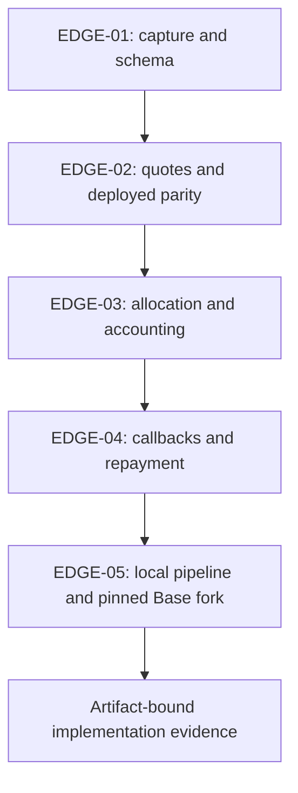

# System Maps: Aerodrome specification and implementation

## Specification delivery

Done refers only to the specification. These executable proofs validate schemas, mathematical examples, accounting and repository dependencies. They are not Aero execution proofs.

```json nim-deliver
{
  "featureId": "aero-split-routing-spec",
  "taskType": "feature",
  "status": "Done",
  "input": {
    "entrypoint": "node scripts/verify-aero-spec.mjs",
    "payload": "Versioned research specification, embedded schemas, synthetic examples and current dependency hashes; no secrets or network calls."
  },
  "processing": {
    "apiHops": [
      "local Ajv schema validation -> independent math/accounting -> source hash and symbol checks -> E2E requirement checks"
    ],
    "datastores": [
      "docs/ratio.md",
      "docs/features/aero-split-routing.spec.json"
    ],
    "services": []
  },
  "output": {
    "state": "Validated specification package only; production Aero implementation has separate executable evidence below.",
    "transitions": [
      "draft -> schema/math/dependency validation -> reviewed spec",
      "implementation Draft -> local/fork proof -> implementation Done"
    ]
  },
  "seams": [
    {
      "id": "request-schema",
      "description": "Request and result schema validation; this is documentation evidence only."
    },
    {
      "id": "formula-units",
      "description": "Independent arithmetic examples for fee flooring, ratios and Q96."
    },
    {
      "id": "plan-accounting",
      "description": "Selected-plan accounting, cycle continuity and shared-state counterexample."
    },
    {
      "id": "existing-dependencies",
      "description": "Existing integration symbols and exact source hashes; no claim that they support Aero."
    },
    {
      "id": "implementation-handoff",
      "description": "Complete five-edge E2E contract with separate implementation evidence."
    }
  ],
  "edgeProofs": [
    {
      "edgeId": "EDGE-01",
      "seamId": "request-schema",
      "command": "node scripts/verify-aero-spec.mjs --edge EDGE-01",
      "logMarker": "AERO_SPEC_EDGE_01",
      "sourceFiles": [
        "scripts/verify-aero-spec.mjs"
      ]
    },
    {
      "edgeId": "EDGE-02",
      "seamId": "formula-units",
      "command": "node scripts/verify-aero-spec.mjs --edge EDGE-02",
      "logMarker": "AERO_SPEC_EDGE_02",
      "sourceFiles": [
        "scripts/verify-aero-spec.mjs"
      ]
    },
    {
      "edgeId": "EDGE-03",
      "seamId": "plan-accounting",
      "command": "node scripts/verify-aero-spec.mjs --edge EDGE-03",
      "logMarker": "AERO_SPEC_EDGE_03",
      "sourceFiles": [
        "scripts/verify-aero-spec.mjs"
      ]
    },
    {
      "edgeId": "EDGE-04",
      "seamId": "existing-dependencies",
      "command": "node scripts/verify-aero-spec.mjs --edge EDGE-04",
      "logMarker": "AERO_SPEC_EDGE_04",
      "sourceFiles": [
        "scripts/verify-aero-spec.mjs"
      ]
    },
    {
      "edgeId": "EDGE-05",
      "seamId": "implementation-handoff",
      "command": "node scripts/verify-aero-spec.mjs --edge EDGE-05",
      "logMarker": "AERO_SPEC_EDGE_05",
      "sourceFiles": [
        "scripts/verify-aero-spec.mjs"
      ]
    }
  ]
}
```

## Implementation delivery — not executed

The following map is Done from actual Node, Foundry, local pipeline and pinned-fork proof results. Its final edge audits saved receipts against the current executor artifact; the commands in the feature brief regenerate those receipts.

```json nim-deliver
{
  "featureId": "aero-split-routing-implementation",
  "taskType": "feature",
  "status": "Done",
  "input": {
    "entrypoint": "src/aero/cli.ts capture|plan|simulate",
    "payload": "Pinned Base request, admitted protocol profiles and new artifact capability"
  },
  "processing": {
    "apiHops": [
      "capture -> projection -> allocation -> calldata -> full flashloan simulation -> receipt verification"
    ],
    "datastores": [
      "Pinned request JSON",
      ".nim/e2e/aero-local.json",
      ".nim/e2e/aero-fork.json"
    ],
    "services": [
      "explicit archive Base RPC",
      "localhost Anvil only"
    ]
  },
  "output": {
    "state": "Verified Aero plans, local/fork repayment and retained custody; deployment evidence is separate.",
    "transitions": [
      "captured -> projected -> selected|rejected",
      "selected -> simulated -> admitted|rejected",
      "local execution -> debt repaid and opening balances preserved"
    ]
  },
  "seams": [
    {
      "id": "capture",
      "description": "Chain/block/generation/profile validation"
    },
    {
      "id": "quotes",
      "description": "Native integer and deployed quote parity"
    },
    {
      "id": "allocation",
      "description": "Complete cyclic integer allocation and costed subsets"
    },
    {
      "id": "callbacks",
      "description": "Typed artifact, authenticated callbacks and repayment"
    },
    {
      "id": "e2e",
      "description": "Local full pipeline and pinned-fork parity, no broadcasts"
    }
  ],
  "edgeProofs": [
    {
      "edgeId": "EDGE-01",
      "seamId": "capture",
      "command": "node --test dist/test/aero-state.test.js",
      "logMarker": "AERO_IMPL_EDGE_01",
      "sourceFiles": [
        "src/test/aero-state.test.ts"
      ]
    },
    {
      "edgeId": "EDGE-02",
      "seamId": "quotes",
      "command": "node --test dist/test/aero-quotes.test.js",
      "logMarker": "AERO_IMPL_EDGE_02",
      "sourceFiles": [
        "src/test/aero-quotes.test.ts"
      ]
    },
    {
      "edgeId": "EDGE-03",
      "seamId": "allocation",
      "command": "node --test dist/test/aero-split.test.js",
      "logMarker": "AERO_IMPL_EDGE_03",
      "sourceFiles": [
        "src/test/aero-split.test.ts"
      ]
    },
    {
      "edgeId": "EDGE-04",
      "seamId": "callbacks",
      "command": "forge test --offline --match-contract AeroSplitExecutorTest",
      "logMarker": "testCLExactInputAndCanonicalCallback",
      "sourceFiles": [
        "test/AeroSplitExecutor.t.sol"
      ]
    },
    {
      "edgeId": "EDGE-05",
      "seamId": "e2e",
      "command": "node scripts/verify-aero-implementation.mjs",
      "logMarker": "AERO_IMPL_EDGE_05",
      "sourceFiles": [
        "scripts/verify-aero-implementation.mjs",
        "scripts/aero-local-e2e.mjs",
        "scripts/aero-fork-e2e.mjs"
      ]
    }
  ]
}
```

## Mandatory chaos scenarios

| Edge | Injected failure | Required outcome |
| --- | --- | --- |
| EDGE-01 | Wrong chain/head or changed clone implementation/module | Reject before quote or signature |
| EDGE-02 | Missing next bitmap word or stable arithmetic/nonconvergence | Typed incomplete/failed quote; no extrapolation |
| EDGE-03 | Shared counter-pool reused from initial state, cost duplicated or budget exhausted | Sequential replay; conserved inputs; honest best-found/rejection |
| EDGE-04 | Forged/double/nested callback or opening funds masking a loss | Atomic revert; no unauthorized token payment |
| EDGE-05 | Head changes/cancellation after the last awaited RPC, or unknown receipt | Zero sends after cancellation; rebuild or reconcile; no blind retry |

## Test flow



The separate spec checker exercises specification invariants. All implementation edges require independent fixtures, structured AERO_IMPL_EDGE_0N log events and actual command results. Fork reports must distinguish constructed liquidity from naturally observed state.
