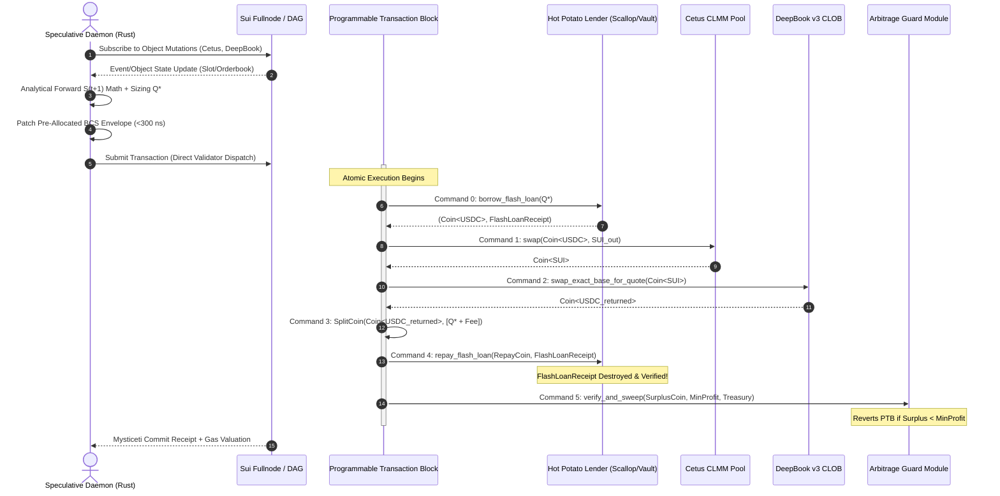

# Sui Hot Potato Flashloan Architecture & Protocol Integration

## 1. Sui Blockchain Fundamentals & The Move Execution Model

Sui deviates fundamentally from EVM chains by replacing account balances with an **object-centric data model** and monolithic transactions with **Programmable Transaction Blocks (PTBs)**.

### 1.1 Object Ownership & Consensus Paths

Every piece of state in Sui is an object identified by a 32-byte `ID` with a monotonically increasing `version` sequence number:

```
┌────────────────────────────────────────────────────────────────────────┐
│                          SUI OBJECT TOPOLOGY                           │
├────────────────────┬────────────────────┬──────────────────────────────┤
│ OBJECT TYPE        │ OWNERSHIP MODEL    │ CONSENSUS PATHWAY            │
├────────────────────┼────────────────────┼──────────────────────────────┤
│ Gas Coin / Caps    │ Single-Owner       │ Fast Path (No Consensus)     │
│ (`OperatorCap`)    │ (Operator Address) │ Finality in < 400 ms         │
├────────────────────┼────────────────────┼──────────────────────────────┤
│ Liquidity Pools    │ Shared Object      │ Mysticeti DAG BFT Consensus  │
│ (Cetus, DeepBook)  │ (Mutable by all)   │ Finality in ~ 300 - 400 ms   │
└────────────────────┴────────────────────┴──────────────────────────────┘
```

1. **Fast-Path Single-Writer Execution**:
   - Transactions modifying only single-owner objects (e.g., operator gas coins, private vaults) bypass global consensus entirely, achieving Byzantine-resilient finality in one round trip.
2. **Mysticeti DAG-Based Consensus for Shared Objects**:
   - Shared objects like DEX pools (Cetus, DeepBook, Scallop) are sequenced through Mysticeti, achieving deterministic multi-validator ordering in 3 rounds (~300–400 ms).

### 1.2 Programmable Transaction Blocks (PTB)

In EVM, executing multiple actions atomically (e.g. flash borrow $\to$ swap A $\to$ swap B $\to$ repay) requires deploying an intermediary router contract. On Sui, **PTBs natively execute up to 1,024 heterogeneous commands in a single atomic envelope**:

- **Command Chaining**: The output of Command $i$ (`Argument::Result(i)` or `Argument::NestedResult(i, j)`) can be passed directly as the input to Command $i+1$.
- **Native Atomicity**: If any command aborts or encounters an unhandled runtime error, all state mutations across all commands are completely reverted.
- **Gas Smashing & Multi-Coin Management**: Sui automatically selects and smashes gas coins, eliminating the complex WETH/ETH wrapping and unwrapping overhead typical of EVM.

---

## 2. The Hot Potato Pattern: Mechanics & Mathematical Safety

### 2.1 The Four Move Abilities

Move enforces strict type capabilities through four primitive abilities:
- `copy`: Value can be cloned or duplicated.
- `drop`: Value can be silently discarded when it goes out of scope.
- `store`: Value can be placed inside another struct or saved to global storage.
- `key`: Value can serve as a top-level addressable object (`has key, store`).

### 2.2 What is a Hot Potato?

A **Hot Potato** is a Move struct that possesses **NONE** of the four abilities:

```move
public struct FlashLoanReceipt {
    pool_id: ID,
    loan_amount: u64,
    fee_amount: u64,
}
```

```
                     HOT POTATO LIFECYCLE IN MOVE

   [ Lender Module ]
          │
          ├─► borrow_flash_loan() ──► Produces (Coin<T>, FlashLoanReceipt)
          │                                                    │
          ▼                                                    ▼
   [ Arbitrage Hops ] ──► (Swap across Cetus & DeepBook)     CANNOT BE DROPPED
          │                                                  CANNOT BE STORED
          │                                                  CANNOT BE COPIED
          ▼                                                    │
   [ Lender Module ]                                           │
          │                                                    ▼
          └─► repay_flash_loan() ◄─────────────────────────────┘
                │
                └──► Destructs FlashLoanReceipt & Validates Repayment
```

#### Why the Hot Potato is Structurally Unexploitable:
1. **Compile-Time Linear Resource Requirement**:
   Because `FlashLoanReceipt` lacks `drop`, the Move bytecode verifier guarantees that the variable **must be consumed** before the transaction terminates. If the PTB ends without calling `repay_flash_loan`, compilation/verification aborts with `UnusedValueWithoutDrop`.
2. **No Storage or Transfer Evasion**:
   Because it lacks `store` and `key`, an attacker cannot save the receipt into a dynamic field, wrap it in another struct, or transfer it to another address to evade repayment.
3. **No Replay or Duplication**:
   Because it lacks `copy`, the borrower cannot clone a receipt to repay one loan while keeping another unpaid.
4. **Encapsulated Destruction**:
   In Move, a struct's private fields can only be destructured by the module that defined it. Therefore, only the issuing `hot_potato_lender` module can unpack and destroy `FlashLoanReceipt`.

---

## 3. Integrated Sui Protocols

### 3.1 Flash Loan Providers

#### 1. Scallop Protocol
- **Module**: `scallop_protocol::flash_loan`
- **Functions**:
  ```move
  public fun borrow_flash_loan<T>(pool: &mut Market, amount: u64, ctx: &mut TxContext): (Coin<T>, FlashLoanReceipt<T>);
  public fun repay_flash_loan<T>(pool: &mut Market, coin: Coin<T>, receipt: FlashLoanReceipt<T>);
  ```
- **Fee**: Configurable per asset, typically 0.05% or 0% for authorized market makers.

#### 2. NAVI Protocol
- **Module**: `navi::flash_loan`
- **Functions**:
  ```move
  public fun borrow<CoinType>(pool: &mut Pool<CoinType>, amount: u64, ctx: &mut TxContext): (Coin<CoinType>, Receipt<CoinType>);
  public fun repay<CoinType>(pool: &mut Pool<CoinType>, coin: Coin<CoinType>, receipt: Receipt<CoinType>);
  ```

#### 3. Custom Hot Potato Lender (`hot_potato_lender`)
- Dedicated zero-fee flash vault deployed as part of `sui-flash-executor`, funded by operator or private LP capital.

---

### 3.2 DEX Venues for Arbitrage Execution

#### 1. Cetus CLMM (Concentrated Liquidity Market Maker)
- **Architecture**: Uniswap V3-style concentrated liquidity with tick intervals, tick bitmaps, and $\sqrt{P} \in Q64.64$.
- **Swap Entry**:
  ```move
  public fun swap<CoinA, CoinB>(
      config: &GlobalConfig,
      pool: &mut Pool<CoinA, CoinB>,
      coin_a: Coin<CoinA>,
      coin_b: Coin<CoinB>,
      a2b: bool,
      by_amount_in: bool,
      amount: u64,
      amount_limit: u64,
      sqrt_price_limit: u128,
      clock: &Clock,
      ctx: &mut TxContext
  ): (Coin<CoinA>, Coin<CoinB>);
  ```

#### 2. DeepBook v3 (Central Limit Order Book)
- **Architecture**: Sui's institutional-grade native on-chain orderbook matching engine, supporting limit, market, and fill-or-kill orders.
- **Swap Entry**:
  ```move
  public fun swap_exact_base_for_quote<Base, Quote>(
      pool: &mut Pool<Base, Quote>,
      base_coin: Coin<Base>,
      deep_fee_coin: Coin<DEEP>,
      min_quote_out: u64,
      clock: &Clock,
      ctx: &mut TxContext
  ): (Coin<Quote>, Coin<Base>, Coin<DEEP>);
  ```

---

## 4. End-to-End Sequence Diagram


